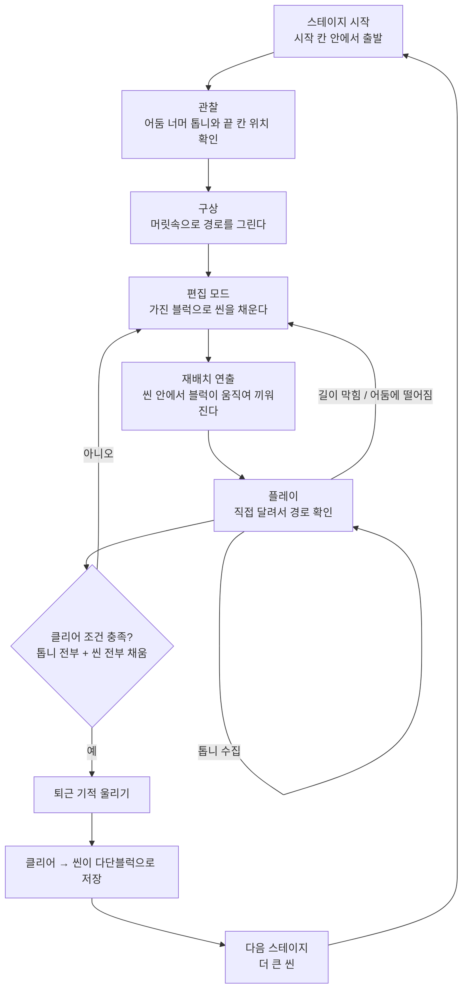
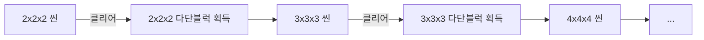

# Charlie — 게임 흐름 기획서

> 모던 타임즈 공장을 배경으로, **맵을 직접 조립하고 그 안을 3인칭으로 달리는** 3D 플랫포머

---

## 1. 개요

| 항목 | 내용 |
|---|---|
| 장르 | 3D 플랫포머 + 공간 조립 퍼즐 |
| 시점 | 3인칭 (TPS) |
| 배경 | 찰리 채플린 〈모던 타임즈〉풍의 공장 |
| 핵심 재미 | 내가 조립한 맵을 내가 달린다. 조립이 틀리면 안에 들어가서 몸으로 깨닫고, 다시 조립한다 |
| 톤 | 장난감 같은 공장 기계 + 무성영화 필름 질감 |

플레이어는 공장 노동자다. 빈 정육면체 공간을 공장 블럭으로 채워 출근 게이트에서 퇴근 기적까지 가는 길을 만들고, 그 길을 직접 올라가 퇴근하는 것이 목표다.

---

## 2. 스케일 기준

플레이어와 맵의 비율. 1 유닛은 약 1m로 본다.

### 2.1 플레이어

| 항목 | 수치 |
|---|---|
| 키 | 1.75 |
| 몸 너비 (지름) | 0.7 |
| 그냥 넘어가는 단차 | 0.6 |
| 점프 높이 (1단) | 약 2.3 |
| 연속 점프 2단 | 약 3.1 |
| 연속 점프 3단 | 약 4.2 |

### 2.2 맵

| 항목 | 수치 | 플레이어 대비 |
|---|---|---|
| 블럭 한 칸 (가로 = 세로 = 높이) | 21 | 키의 12배 |
| 블럭 바닥 타일 (한 칸을 3x3 으로 나눈 한 장) | 7 | 키의 4배 |
| 2x2x2 씬 한 변 | 42 | 키의 24배 |
| 3x3x3 씬 한 변 | 63 | 키의 36배 |
| 4x4x4 씬 한 변 | 84 | 키의 48배 |

- 한 층(블럭 한 칸)을 올라가려면 1단 점프로 약 9번, 3단 점프로 약 5번 높이를 쌓아야 한다. 블럭 안에는 이 높이를 오를 수 있는 오르막이 반드시 있어야 한다.

---

## 3. 전체 게임 흐름

한 스테이지는 **관찰 → 구상 → 조립 → 플레이 → 재조립**의 반복이다. 편집과 플레이는 언제든 오갈 수 있고, 이 반복 자체가 퍼즐을 푸는 과정이다.

---

## 4. 씬 구성

### 4.1 기본 형태
- 씬은 정육면체 그리드다. 스테이지가 진행될수록 커진다 (2x2x2 → 3x3x3 → 4x4x4).
- 위아래가 있다. 아래층에서 시작해 위층으로 올라가는 구조다.
- 씬의 바깥 테두리는 공장 외벽이고, 지붕은 열려 있다.

### 4.2 고정 칸
- **시작 칸**: 아래층의 한쪽 구석. 출근 게이트가 있고 플레이어는 여기서 시작한다.
- **끝 칸**: 위층의 반대편. 퇴근 기적이 있다.
- 두 칸은 편집할 수 없다.

### 4.3 빈 칸 = 어둠
- 처음에는 시작 칸과 끝 칸을 뺀 나머지가 모두 비어 있다.
- 빈 칸은 아무것도 없는 공간이다. 그 너머에 설치해 둔 블럭 내부가 그대로 보인다.
- 빈 칸에 들어가면 사망한다 (7장 참고).

### 4.4 처음부터 보이는 정보
- 허공에 떠 있는 **톱니의 위치**
- **끝 칸(퇴근 기적)의 위치**
- 이 정보는 어둠과 블럭 너머로도 항상 보인다. 플레이어는 이걸 보고 대략적인 경로를 구상한다.

---

## 5. 조립(편집 모드) 작동 방식

### 5.1 진입
- 플레이 중 **언제든** 편집 모드로 들어갈 수 있다.
- 편집 모드에서는 씬 전체를 축소한 조립 화면이 나오고, 아래쪽에 가진 블럭 목록이 나온다.

### 5.2 기본 조작
| 동작 | 설명 |
|---|---|
| 배치 | 블럭을 골라 빈 칸에 놓는다. 마우스가 가리키는 칸에 맞춰 들어갈 수 있는 위치를 자동으로 찾는다 |
| 회수 | 이미 놓은 블럭을 다시 목록으로 가져온다 |
| 회전 | 모든 방향(24방향)으로 돌릴 수 있다. 화면 기준 축으로 돌린다 |
| 시점 | 조립 화면을 돌려 보고 확대·축소한다 |

### 5.3 회전하면 안의 맵도 회전한다
- 블럭을 돌려서 넣으면 그 블럭 안의 맵도 똑같이 돌아간다.
- 바닥이 옆을 보게 넣으면 그 블럭의 바닥은 벽이 되고, 계단은 옆으로 눕는다.
- 그래서 같은 블럭이라도 **어디에, 어느 방향으로** 넣느냐에 따라 길이 완전히 달라진다.

### 5.4 편집 화면에 보여 주는 것 / 숨기는 것
- **보여 준다**: 블럭 종류(색), 그 블럭의 바닥 방향, 톱니·플레이어 위치
- **숨긴다**: 블럭 안의 발판 배치, 블럭끼리 발판이 이어지는지
- 숨기는 이유: 직접 들어가 확인하고 다시 편집하는 시행착오가 곧 플레이이기 때문

### 5.5 외면 / 내면 규칙
- 블럭의 각 면은 씬 안에 놓인 위치에 따라 외면이 되거나 내면이 된다.
- **내면(씬 안쪽)에는 벽이 없다.** 이웃한 블럭들은 하나의 큰 공간으로 이어진다.
- **외면(씬 테두리)만 벽이다.**
- 블럭 사이를 오가는 건 벽이 아니라 **발판이 이어지느냐**로 결정된다.
  - 옆 블럭: 맞닿은 쪽 발판 높이가 이어지면 건널 수 있다.
  - 위 블럭: 아래 블럭의 오르막 끝 바로 위에 위 블럭 바닥의 구멍이 있어야 올라갈 수 있다.
  - 아래 블럭: 바닥 구멍으로 떨어져 내려갈 수 있다.

### 5.6 서 있는 블럭도 편집 가능
- 플레이어가 지금 서 있는 블럭도 옮기거나 돌리거나 뺄 수 있다.
- 옮기거나 돌리면 플레이어도 그 블럭에 실려 함께 이동한다.
- 빼 버리면 플레이어도 함께 어둠으로 떨어진다.

### 5.7 재배치 연출
편집을 마치고 씬으로 돌아오면, **씬 안에서** 바뀐 내용이 실제로 일어나는 장면을 보여 준다.

1. 카메라가 살짝 물러나며 씬 가운데를 향한다.
2. **빠지는 블럭**이 어둠 속으로 날아가며 사라진다.
3. **옮긴 블럭**이 하나씩 호를 그리며 새 자리로 이동하고 회전한다.
4. **새 블럭**이 바깥에서 날아와 하나씩 끼워진다.
5. 연출이 끝나면 카메라가 플레이어 뒤로 돌아오고 조작이 재개된다.

플레이어 주변에서 세계가 재조립되는 장면(인셉션 같은 느낌)이 핵심이다.

---

## 6. 플레이(씬 모드)

### 6.1 플레이어 능력
현재는 두 가지이고, 이후 추가할 예정이다.

| 능력 | 설명 |
|---|---|
| **점프** | 기본 이동 수단. 달리면서 연속으로 뛰면 점점 높이 뛴다 (최대 3단) |
| **멜빵 (스패너)** | 씬 안에서 멜빵을 얻으면 스패너를 쓸 수 있다. 다단블럭의 잠긴 패널 나사를 푼다 (6.3) |

- 그 밖의 이동(오르막, 승강기 등)은 플레이어 능력이 아니라 **블럭 안의 기믹**으로 해결한다.

### 6.2 카메라
- 카메라와 캐릭터 사이를 가리는 오브젝트는 잠시 반투명해진다.
- 카메라가 벽에 밀려 확대되지 않고 항상 일정한 거리를 유지한다.

### 6.3 다단블럭 탐방 (멜빵)
- 다단블럭은 원래 씬이었기 때문에 바깥 껍데기가 있다.
- 다른 씬에 끼워 넣으면 껍데기의 일부가 씬 안쪽을 향하게 된다. 그 면은 **나사로 잠긴 패널**이 된다.
- 잠긴 패널은 단단한 면이라 **발판이나 벽으로 쓸 수 있다.**
- 멜빵을 얻은 상태에서 패널 꼭짓점의 나사를 모두 풀면 그 면이 열려 다단블럭 안을 탐방할 수 있다.
- 멜빵은 **그 씬 안에서만** 유효하다. 다음 씬에서는 다시 찾아야 한다.
- 그래서 다단블럭은 "닫힌 채로 지형으로 쓸지, 열어서 안의 경로를 쓸지"를 고르는 선택지가 된다.

---

## 7. 실패와 복귀

| 상황 | 처리 |
|---|---|
| 빈 칸(어둠)에 들어감 | 사망 → 떨어지기 직전에 밟고 있던 발판으로 복귀 |
| 복귀 지점의 블럭이 편집으로 옮겨짐 | 옮겨진 블럭의 같은 자리로 복귀 |
| 복귀 지점의 블럭이 편집으로 빠짐 | 시작 칸으로 복귀 |
| 서 있던 블럭을 편집으로 뺌 | 블럭과 함께 어둠으로 떨어진 뒤 위 규칙대로 복귀 |

- 사망 페널티는 가볍다. 복귀가 빠르니 마음껏 시험해 보고 다시 조립하게 하는 것이 목적이다.
- 언제든 시작 칸으로 돌아가는 기능도 있다.

---

## 8. 스테이지 클리어

### 8.1 클리어 조건
아래 세 가지를 모두 충족해야 한다.
1. 씬의 **톱니를 모두** 모은다.
2. 씬의 **모든 칸을 블럭으로 채운다.** (빈 칸이 하나도 없어야 한다)
3. 끝 칸의 **퇴근 기적**에 닿아 울린다.

조건이 덜 채워진 상태로 퇴근 기적에 가면 무엇이 부족한지 알려 준다.

### 8.2 클리어 보상
- 클리어한 씬 전체가 **다단블럭**으로 저장된다.
- 이 블럭 안에는 내가 조립한 배치, 각 블럭의 회전, 시작·끝 칸까지 그대로 들어 있다.

### 8.3 난이도가 만들어지는 지점
- **위로 올라가기**: 아래층에서 위층까지 올라가려면 수직 이동이 되는 블럭이 경로에 있어야 하고, 위아래 블럭의 구멍이 맞아야 한다.
- **블럭 모양**: 여러 칸짜리 단블럭은 필요 없는 칸까지 차지해서 다른 경로를 막기도 한다.
- **한정된 블럭**: 원하는 블럭이 없으면 돌아가는 길을 짜야 한다.
- **톱니 위치**: 끝 칸과 반대쪽 허공에 있는 톱니는 우회 경로를 강제한다.
- **전부 채우기**: 경로를 다 만든 뒤에도 남은 칸을 채워야 하는데, 남은 블럭이 이미 만든 길을 막을 수 있다.

---

## 9. 진행 구조

- **2x2x2 씬**에서 시작해 씬이 점차 커진다: 2x2x2 → 3x3x3 → 4x4x4.
- 2x2x2 씬은 조립과 플레이의 기본을 익히는 단계다.
- 다음 씬부터는 이전에 만든 다단블럭이 인벤토리에 들어온다.
  - 블럭이 모자라서 **다단블럭을 꼭 써야 하는 씬**이 있다.
  - 다단블럭을 **써도 되고 안 써도 되는 씬**도 있다. 이전에 내가 만든 구조가 이번 경로에 효율적이라면 쓰는 게 이득이다.
- 내가 과거에 조립한 결과가 다음 퍼즐의 재료가 된다. 그래서 조립 하나하나가 이후 플레이에 영향을 준다.

---

## 10. 연출과 톤

- **무성영화 필름**: 세피아 톤, 화면 깜빡임, 필름 스크래치와 먼지. 켜고 끌 수 있다.
- **장난감 공장**: 통통하고 단순한 기계 형태, 끝없이 돌아가는 톱니와 볼트, 뿜어져 나오는 증기.
- **주인공**: 중절모와 작업복 차림의 공장 노동자. 멜빵을 얻으면 외형에 멜빵과 스패너가 나타난다.

---

## 11. 추후 검토 항목

- 점프·멜빵 이후 추가할 플레이어 능력
- 4x4x4보다 큰 씬의 도입 여부
- 다단블럭이 여러 개 쌓였을 때의 인벤토리 운용
- 스테이지별 난이도 곡선과 톱니 개수
- 클리어 기록(사망 횟수, 편집 횟수, 시간)에 따른 평가
