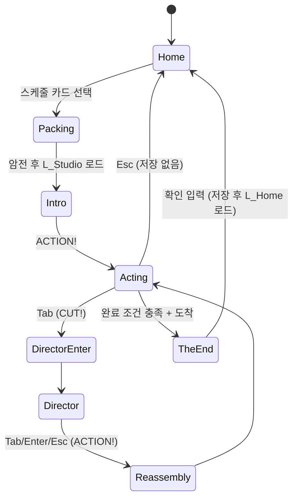

# 언리얼 엔진 기능 구현 명세

> OpenGL 프로토타입을 언리얼 엔진으로 재구성하기 위한 **기능 구현 전용** 문서.
> 모든 비주얼은 그레이박스(기본 도형 + 단색 머티리얼)로 만들고, 에셋은 차후에 교체한다.
> 블럭 내부 레벨 디자인, 블럭 종류·개수, 촬영별 구성, 이동·점프 수치는 **차후 후술**한다.
>
> 기획 원문: [씬 조립](기획서_씬조립.md) · [플랫포머](기획서_플랫포머.md) · [핵심 메커니즘](기획서_핵심메커니즘.md) · [전체](기획서_전체.md)

---

## 목차
1. [목표와 범위](#1-목표와-범위)
2. [프로젝트 구성](#2-프로젝트-구성)
3. [좌표계와 단위](#3-좌표계와-단위)
4. [데이터 구조](#4-데이터-구조)
5. [클래스 구성](#5-클래스-구성)
6. [게임 흐름과 상태](#6-게임-흐름과-상태)
7. [시스템별 기능 명세](#7-시스템별-기능-명세)
8. [입력 (Enhanced Input)](#8-입력-enhanced-input)
9. [UI (UMG)](#9-ui-umg)
10. [저장](#10-저장)
11. [디버그 기능](#11-디버그-기능)
12. [구현 순서](#12-구현-순서)
13. [완료 확인 체크리스트](#13-완료-확인-체크리스트)
14. [차후 후술](#14-차후-후술)

---

## 1. 목표와 범위

### 1.1 목표
에셋 없이 **게임이 처음부터 끝까지 돌아가는 상태**를 만든다.
방 → 촬영 선택 → 세트 소개 → 연기 ↔ 감독 반복 → THE END → 다단블럭 저장 → 방 귀환.

### 1.2 범위

| 구현 | 차후 후술 |
|---|---|
| 세트 그리드, 조각 배치·회수·24방향 회전 | 블럭 종류와 내부 지형·기믹 |
| 블럭 내부 맵이 조각과 함께 회전 | 촬영별 조각 개수·모양·구성 |
| 외면 벽 / 내면 개방 | 시작·도착 지점의 정확한 위치 |
| 다단블럭 저장·재사용, 패널과 나사 | 톱니 위치와 개수 |
| 감독 모드 UI, 미리보기 | 이동·점프 수치 튜닝 |
| 세트 안 재배치 연출, 찰리 탑승 | 아트 에셋, 애니메이션, 사운드 |
| 3인칭 캐릭터, 2단 점프, 카메라 가림 처리 | |
| 톱니·멜빵·도착 지점, 어둠 판정, 복귀 | |
| 완료 조건, THE END, 포스터 | |
| 방(홈), 스케줄 보드, 거울, 필름 선반, 포스터 벽 | |
| 연출(세트 소개, CUT/ACTION, 크레인) | |
| 저장/불러오기 | |

### 1.3 그레이박스 원칙
- 메시는 엔진 기본 도형(Cube, Cylinder, Sphere)만 쓴다.
- 머티리얼은 마스터 머티리얼 하나에 색·발광·페이드 파라미터만 둔다.
- 나중에 에셋을 입힐 때 **로직 클래스는 그대로 두고 메시/머티리얼만 교체**할 수 있게, 비주얼은 컴포넌트나 자식 블루프린트로 분리한다.

---

## 2. 프로젝트 구성

### 2.1 맵

| 맵 | 내용 |
|---|---|
| `L_Home` | 찰리의 방 (1인칭) |
| `L_Studio` | 촬영장. 세트는 실행 중 동적으로 생성 |
| `L_BlockSandbox` (개발용) | 블럭 하나를 단독으로 만들고 테스트하는 맵 |

### 2.2 구현 방식
- 핵심 로직(그리드, 회전, 배치 판정, 생성기, 저장)은 **C++**.
- 연출, UI 연결, 튜닝 값은 **블루프린트**에서 C++ 클래스를 상속해 다룬다.
- 튜닝 값은 모두 `UPROPERTY(EditAnywhere)` 또는 데이터 에셋으로 노출한다.

### 2.3 폴더

```
Content/
  Core/            GameMode, GameInstance, PlayerController, SaveGame
  Set/             SetGrid, Piece, Block, Panel, Shell
  Acting/          Character, Camera, Pickups, Goal
  Director/        DirectorPawn, Preview, Reassembly
  Home/            HomeCharacter, Interactables
  Sequences/       Intro, Crane, TheEnd
  UI/              Widgets
  Data/            BlockTypes, Takes, Rotations
  Blocks/          블럭별 내부 레벨 (차후 후술)
  Graybox/         M_Graybox, 기본 메시 인스턴스
```

---

## 3. 좌표계와 단위

- 언리얼은 **Z가 위**, 단위는 cm다. 프로토타입(Y가 위)에서 옮길 때 축을 바꾼다.
- 그리드 인덱스는 `FIntVector(X, Y, Z)`, Z가 층이다.

| 값 | 정의 |
|---|---|
| `CellSize` | 칸 한 변 길이. 세트 설정에서 지정 (차후 확정) |
| `N` | 세트 한 변 칸 수 (2, 3, 4) |
| 세트 원점 | 세트 바닥 가운데. 세트는 원점 기준 X·Y로 ±N·CellSize/2, Z로 0~N·CellSize |

**인덱스 ↔ 월드**
```
CellCenter(i) = SetOrigin + ( (i.X - (N-1)/2) * CellSize,
                              (i.Y - (N-1)/2) * CellSize,
                              i.Z * CellSize + CellSize/2 )
WorldToCell(p) = floor( (p.X - Origin.X) / CellSize + N/2 ),
                 floor( (p.Y - Origin.Y) / CellSize + N/2 ),
                 floor( (p.Z - Origin.Z) / CellSize )
```

- 블럭 내부 맵은 칸 중심을 원점으로 하는 **지역 좌표**로 만든다. 바닥은 지역 -Z 쪽.

---

## 4. 데이터 구조

### 4.1 회전
- 24가지 회전을 미리 만들어 두고 **인덱스(0~23)**로 다룬다. 0은 회전 없음.
- 각 회전은 정수 3x3 행렬(원소가 -1, 0, 1)과 `FQuat` 두 가지 형태로 보관한다.
  - 정수 행렬: 칸 좌표 계산용 (오차 없음)
  - `FQuat`: 액터 회전과 보간용
- 생성: 단위 행렬에서 X·Y·Z 축 90도 회전을 반복 곱해 서로 다른 24개를 모은다.
- 합성 테이블 `Compose[a][b]`와 축별 90도 회전 테이블 `Turn[axis][dir][r]`을 미리 계산해 둔다.

### 4.2 열거형

```cpp
enum class ECellState : uint8 { Empty, Start, Goal, Filled };
enum class EGameFlow  : uint8 { Home, Packing, Intro, Acting, DirectorEnter, Director, Reassembly, TheEnd };
enum class EPickupType: uint8 { Cog, Suspenders };
```

### 4.3 구조체

```cpp
// 블럭 하나 (조각 안의 한 칸)
USTRUCT() struct FBlockCell {
    FIntVector Offset;        // 조각 안에서의 칸 위치
    FName      BlockType;     // 블럭 종류 (차후 후술)
    uint8      LocalRot;      // 조각 안에서의 블럭 방향 (다단블럭 안의 블럭은 저마다 다름)
};

// 조각 (단블럭 / 다단블럭)
USTRUCT() struct FPieceDef {
    TArray<FBlockCell> Cells;
    bool  bMulti = false;     // 다단블럭 여부
    int32 MultiSize = 0;      // 다단블럭 한 변 칸 수
    int32 FromTake = -1;      // 다단블럭이 나온 촬영
};

// 조각의 현재 상태
USTRUCT() struct FPieceState {
    int32      PieceIndex;
    uint8      Rot = 0;       // 0~23
    bool       bPlaced = false;
    FIntVector Pos;           // 회전 후 최소 모서리 칸
    uint8      PanelBolts[6]; // 다단블럭: 면별로 푼 나사 비트 (4비트)
};

// 촬영 정의 (데이터 에셋으로 작성, 내용은 차후 후술)
UCLASS() class UTakeData : public UPrimaryDataAsset {
    FText      Title;
    int32      N;
    FIntVector StartCell, GoalCell;
    TArray<FPieceDef> Pieces;            // 지급 조각
    TArray<FVector>   CogLocations;      // 세트 지역 좌표
    TOptional<FVector> SuspendersLocation;
    int32      RequiredMultiFromTake = -1; // 필수 다단블럭 (-1 이면 없음)
    int32      OptionalMultiFromTake = -1; // 선택 다단블럭
};

// 블럭 종류 정의 (내용은 차후 후술)
UCLASS() class UBlockTypeData : public UPrimaryDataAsset {
    FName  Id;
    FLinearColor EditorColor;            // 감독 모드 표시 색
    TSoftObjectPtr<UWorld> InteriorLevel; // 블럭 내부 레벨 (또는 블루프린트 클래스)
    // 생성기용 요약 (차후 후술): 바닥 타일 3x3, 오르막 끝 타일
    TArray<bool> FloorTiles;
    FIntPoint   ExitTile;
};

// 다단블럭 저장 형식
USTRUCT() struct FMultiBlockSave {
    int32 Size;
    int32 FromTake;
    TArray<FBlockCell> Cells;            // Offset = 세트 안 칸 위치, LocalRot = 최종 방향
};
```

### 4.4 조각의 칸 계산
```
ShapeCells(piece, rot):
    각 셀 c 에 대해 r = RotMatrix[rot] * c.Offset
    모든 r 의 최소 모서리를 빼서 0 기준으로 정규화 (순서는 Cells 와 동일)
블럭 최종 방향 = Compose(piece.Rot, cell.LocalRot)
```

---

## 5. 클래스 구성

| 클래스 | 부모 | 역할 |
|---|---|---|
| `UDCGameInstance` | `UGameInstance` | 진행도, 다단블럭 목록, 포스터, 저장/불러오기. 맵 이동 사이 상태 유지 |
| `ADCStudioGameMode` | `AGameModeBase` | 촬영장 흐름 상태 머신, 완료 판정 |
| `ADCHomeGameMode` | `AGameModeBase` | 방 흐름 |
| `ADCPlayerController` | `APlayerController` | 입력 컨텍스트 전환, 마우스 커서, UI |
| `ASetGrid` | `AActor` | 세트 그리드, 칸 상태, 배치 판정, 외벽 생성, 완성 판정 |
| `APieceActor` | `AActor` | 조각 하나. 자식으로 블럭 액터들을 가짐. 회전·이동의 단위 |
| `ABlockActor` | `AActor` | 블럭 하나. 내부 맵을 자식으로 가짐 |
| `AShellPanel` | `AActor` | 다단블럭의 잠긴 패널. 나사 4개 |
| `ADCCharacter` | `ACharacter` | 연기 모드 찰리. 이동, 2단 점프, 상호작용, 복귀 |
| `UOcclusionFadeComponent` | `UActorComponent` | 카메라를 가리는 오브젝트 반투명 처리 |
| `APickup` | `AActor` | 톱니 / 멜빵 |
| `AGoalPoint` | `AActor` | 도착 지점 |
| `ADirectorPawn` | `APawn` | 감독 모드 시점 (궤도 카메라) |
| `UDirectorComponent` | `UActorComponent` | 선택·미리보기·배치·회수·회전 로직 |
| `UReassemblyComponent` | `UActorComponent` | 편집 전후 비교, 재배치 연출, 찰리 탑승 |
| `ACraneRig` | `AActor` | 촬영 크레인 (첫 감독 진입 연출) |
| `ADCHomeCharacter` | `ACharacter` | 방의 1인칭 찰리 |
| `IInteractable` | `UInterface` | 방 오브젝트 상호작용 (보드, 거울, 선반) |
| `UPuzzleGenerator` | `UObject` | (개발용) 정답 우선 자동 생성기 |
| `UDCSaveGame` | `USaveGame` | 저장 데이터 |

---

## 6. 게임 흐름과 상태



| 상태 | 활성 Pawn | 입력 컨텍스트 | 비고 |
|---|---|---|---|
| Home | `ADCHomeCharacter` | IMC_Home | 1인칭 |
| Packing | 같음 (입력 잠금) | 없음 | 필름통 연출 → 페이드 아웃 |
| Intro | 시퀀스 카메라 | IMC_Skip | 건너뛰기만 |
| Acting | `ADCCharacter` | IMC_Acting | |
| DirectorEnter | 연출 카메라 | 없음 | 크레인 또는 빠른 전환 |
| Director | `ADirectorPawn` | IMC_Director | 커서 표시 |
| Reassembly | `ADCCharacter` (이동 잠금) | IMC_Skip + 시점 | |
| TheEnd | 연출 카메라 | IMC_Skip | 일정 시간 뒤 확인 가능 |

- 상태 전환은 `ADCStudioGameMode::SetFlow(EGameFlow)` 한 곳에서만 한다.
- Pawn 교체는 `Possess`로 하되, 연기용 캐릭터는 세트에 그대로 남겨 둔다(감독 모드의 대역 찰리 역할).

---

## 7. 시스템별 기능 명세

### 7.1 세트 그리드 (`ASetGrid`)

**보관 정보**
- `N`, `CellSize`, `Cells: TArray<int32>` (칸 → 조각 번호, -1 빈 칸, -2 시작, -3 도착)
- `PieceStates: TArray<FPieceState>`, `PieceActors: TArray<APieceActor*>`

**함수**

| 함수 | 동작 |
|---|---|
| `Init(UTakeData*, multiBlocks)` | 그리드 생성, 고정 칸 지정, 지급 조각 목록 구성 |
| `RebuildOccupancy()` | 놓인 조각들로 칸 상태 다시 계산 |
| `CanPlace(piece, rot, pos, ignorePiece)` | 모든 칸이 세트 안 + 빈 칸(또는 자기 자신)인지 |
| `Place / Remove(piece)` | 상태 변경 + 액터 스폰/숨김 + 외벽·패널 갱신 |
| `IsComplete()` | 빈 칸이 0개인지 |
| `CellAt(world)` / `CellCenter(index)` | 3장 공식 |
| `RebuildShell()` | 외벽 생성 (7.4) |

### 7.2 조각과 블럭 (`APieceActor`, `ABlockActor`)

**계층**
```
APieceActor  (루트 = 조각 중심, 회전 = Rot)
 ├─ ABlockActor (칸 0)  상대 위치 = (셀 오프셋 - 조각 중심) * CellSize, 상대 회전 = LocalRot
 │    └─ 내부 맵 (Packed Level Actor 또는 블루프린트 자식 액터)
 ├─ ABlockActor (칸 1)
 └─ AShellPanel (다단블럭의 안쪽 껍데기 면마다)
```

- 조각 전체가 **하나의 트랜스폼**으로 움직인다. 회전·이동·재배치 연출은 `APieceActor`의 트랜스폼만 바꾸면 내부 맵과 충돌체가 함께 따라온다.
- 블럭 내부 맵은 칸 중심 기준 지역 좌표로 만든다. 권장 방식은 **Packed Level Actor**(블럭마다 레벨 하나로 디자인 → 액터로 패킹). 대안은 블루프린트 액터.
- 내부 맵의 충돌은 모두 정적 메시 충돌로 처리한다. 회전된 블럭에서도 그대로 동작한다.
- 중력은 항상 월드 -Z다. 블럭이 회전해도 중력은 바꾸지 않는다.
- 블럭 경계 표시용 바닥 가장자리 띠는 `ABlockActor`의 그레이박스 컴포넌트로 둔다.

**그레이박스 블럭 (내부 레벨 디자인 전 임시)**
- 바닥판(3x3 타일, 일부 구멍), 바닥 방향 표시, 오르막(계단형 상자), 블럭 색.
- 블럭 종류 2~3개 정도의 임시 데이터로 전체 기능을 검증한다.

### 7.3 회전 계산
- 감독 모드의 회전 키는 화면 기준 축으로 변환한다.

```
Q/E : 월드 Z 축 기준 ±90도
W/S : 카메라 오른쪽 벡터에 가장 가까운 월드 수평축(X 또는 Y) 기준 ±90도
A/D : 카메라 앞 벡터(수평 성분)에 가장 가까운 월드 수평축 기준 ±90도
새 회전 = Turn[axis][dir] ∘ 현재 회전   (인덱스 테이블 조회)
```

- 같은 키를 네 번 누르면 원래 회전으로 돌아와야 한다.

### 7.4 외면 / 내면

- 블럭 자체에는 벽을 넣지 않는다.
- `ASetGrid::RebuildShell()`이 **세트 테두리 6면 중 측면 4면**에 외벽을 만든다. 바닥은 지면, 지붕은 열어 둔다.
- 외벽은 칸 단위 판(CellSize x CellSize)으로 깔아 둔다. (빈 칸 쪽 외벽도 유지)
- 세트 안쪽은 칸 구분 없이 트인 공간이 된다.

### 7.5 다단블럭과 패널 (`AShellPanel`)

**다단블럭 조각 만들기**
- 촬영 완료 시 `FMultiBlockSave`로 저장 (7.13).
- 다음 촬영에서 `FPieceDef{ bMulti = true }`로 바꿔 지급한다. 칸은 `Size³`개 정육면체.

**패널 생성**
```
다단블럭 조각의 지역 면 f(0~5) 마다:
    월드 방향 d = RotMatrix[rot] * Normal(f)
    그 면이 세트 테두리에 닿으면 → 패널 없음
    PanelBolts[f] == 0b1111 이면 → 패널 없음 (열림)
    아니면 → AShellPanel 스폰 (면 크기 = Size * CellSize, 두께 얇게)
             꼭짓점 4곳에 나사 컴포넌트, 이미 푼 비트는 생략
```
- 패널은 충돌이 있는 단단한 면이다.
- 나사는 상호작용 가능한 컴포넌트(오버랩 구체 + 메시).
- 다단블럭을 옮기거나 돌려도 `PanelBolts`는 유지된다. 패널은 재배치 후 다시 계산한다.

**나사 풀기**
- 연기 모드에서 상호작용 입력 시, 일정 거리 안에서 가장 가까운 나사를 찾는다.
- 멜빵이 없으면 안내만 띄운다.
- 있으면 해당 비트를 켜고 나사를 제거한다. 4개가 모두 풀리면 패널을 없앤다.

### 7.6 감독 모드 (`ADirectorPawn`, `UDirectorComponent`)

**카메라**
- 세트 중심을 도는 궤도 카메라(SpringArm, 충돌 끔).
- 우클릭 드래그로 궤도 회전, 휠로 거리 조절.
- 아래쪽 조각 목록이 차지하는 만큼 세트를 화면 위쪽으로 올려 보이게 한다(뷰포트 오프셋 또는 카메라 각도 조정).

**가리킨 칸 고르기**
```
마우스 → 월드 광선 (DeprojectScreenPositionToWorld)
세트 경계 상자와 교차 구간 [t0, t1] 계산
t0 부터 일정 간격으로 전진하며 칸 조회:
    빈 칸이면 lastEmpty 갱신
    채워진 칸이면 멈춤 (조각 칸이면 hoverPiece 기록)
lastEmpty 가 있으면 그 칸이 대상
```

**미리보기**
- 선택 조각의 칸 목록에서, 각 칸을 대상 칸에 맞춰 보며 `CanPlace`가 되는 첫 위치를 쓴다.
- 미리보기 액터(반투명 그레이박스)를 그 위치·회전으로 표시. 가능 = 초록, 불가 = 빨강.

**표시 규칙**
- 블럭은 종류별 색 + 바닥 방향 표시판만 보인다. 내부 맵은 감독 모드에서 숨긴다(또는 축소 표현용 별도 메시 사용).
- 시작·도착 칸, 톱니·멜빵 위치 마커, 대역 찰리 위치를 표시한다.
- 다단블럭에는 테두리 표시.

> 감독 모드 시점은 실제 세트를 그대로 내려다보는 방식과, 별도의 축소 모형을 쓰는 방식 중 하나를 고른다. 권장은 **실제 세트 위에 감독 모드 표현(색 상자, 바닥 방향 표시)을 덮어 그리고 내부 맵은 숨기는 방식**이다. 재배치 연출과 같은 공간을 쓰게 되어 전환이 자연스럽다.

### 7.7 재배치 연출 (`UReassemblyComponent`)

**편집 전 스냅샷**
- 감독 모드에 들어갈 때 모든 조각의 `(bPlaced, Pos, Rot)`를 저장한다.

**비교와 이벤트**

| 비교 | 이벤트 | 연출 |
|---|---|---|
| 있었음 → 없음 | Remove | 옛 트랜스폼에서 바깥으로 날아가며 회전·축소 후 숨김 |
| 없었음 → 있음 | Add | 바깥 먼 곳에서 회전·확대하며 날아와 새 트랜스폼에 안착 |
| 위치/회전 바뀜 | Move | 옛 트랜스폼 → 새 트랜스폼. 위치는 위로 호를 그리며 보간, 회전은 `FQuat::Slerp` |

- 순서: Remove 동시 → Move 하나씩 → Add 하나씩.
- 전체 길이 상한(기본 2초). 넘으면 모든 이벤트 시간을 비율로 줄인다.
- 바뀐 게 없으면 연출 없이 바로 Acting.
- 건너뛰기 입력 시 모든 이벤트를 최종 상태로 즉시 이동.
- 연출 중 충돌은 최종 배치 기준으로 미리 세팅해 두고, 캐릭터는 이동을 잠근다.

**찰리 탑승**
- 연출 시작 시 찰리 발밑 바닥의 소유 조각을 찾는다(캐릭터의 현재 바닥 정보 → 소유 `APieceActor`).
- 그 조각이 Move면 **캐릭터를 조각 액터에 Attach** → 연출이 끝나면 Detach. 캐릭터 회전은 수평(Yaw)만 유지한다.
- 그 조각이 Remove면 함께 Attach해서 날아간 뒤, 연출이 끝나면 재촬영 처리(7.11).

### 7.8 연기 모드 캐릭터 (`ADCCharacter`)

**이동**
- `CharacterMovementComponent` 사용. 이동 방향은 카메라 Yaw 기준, `bOrientRotationToMovement = true`.
- 걷기/달리기 두 속도, 공중 제어(`AirControl`), 단차(`MaxStepHeight`)는 튜닝 값.
- 움직이는 바닥 위에서는 기본 Based Movement로 함께 실려 간다.

**2단 점프**
- `JumpMaxCount = 2`.
- 발판에서 걸어 떨어진 경우에도 공중 점프 1회가 가능해야 한다. 엔진 기본 동작은 점프 없이 떨어지면 첫 점프를 1회 소모한 것으로 치므로, `JumpMaxCount = 2`이면 공중 점프가 정확히 1회 남는다. 엔진 버전별로 동작을 한 번 확인한다.
- 코요테 타임: 걸어 떨어진 직후 짧은 시간 안의 점프는 1단 점프로 처리.
- 점프 입력 버퍼: 착지 직전 짧은 시간 안에 누른 점프는 착지 순간 실행.
- 2단 점프 시 구분 동작(공중제비) 재생용 이벤트를 블루프린트로 노출한다.

**상호작용**
- 상호작용 입력 → 근처 나사(7.5) 처리.

**튜닝 값 (차후 후술)**: 걷기/달리기 속도, 점프 속도, 중력 배율, 공중 제어, 단차, 코요테 시간, 입력 버퍼 시간.

### 7.9 카메라와 가림 처리 (`UOcclusionFadeComponent`)

**카메라**
- `USpringArmComponent` + `UCameraComponent`. **`bDoCollisionTest = false`** (벽에 밀려 확대되지 않게).
- 어깨 뒤 오프셋(`SocketOffset`), 휠로 `TargetArmLength` 조절.
- 카메라 높이는 지면 아래로 내려가지 않게 제한한다.

**가림 처리**
```
매 틱:
    카메라 위치 → 초점(찰리 머리, 또는 연출의 초점) 으로 Sphere Multi Trace (Visibility)
    걸린 PrimitiveComponent 목록 = 이번 프레임 가림 대상
    가림 대상: Fade 값을 목표 0.12 로, 그 외: 목표 1.0 으로 서서히 보간
    Fade 적용 = 머티리얼 파라미터(Custom Primitive Data 슬롯 0) 로 전달
```
- 마스터 머티리얼 `M_Graybox`는 Masked + **디더 투명(Dither Temporal AA)**으로 `Fade` 값을 처리한다. 반투명 정렬 문제를 피한다.
- 지면(세트 바닥 아래 땅)은 대상에서 뺀다(태그로 구분).
- 연출 카메라(세트 소개, THE END, 크레인)에서도 같은 컴포넌트를 쓰고 초점만 바꾼다.

### 7.10 목표 오브젝트 (`APickup`, `AGoalPoint`)

| 오브젝트 | 판정 | 획득 시 |
|---|---|---|
| 톱니 | 오버랩 구체 | 개수 +1, 숨김, 안내 + 화면 번쩍임 |
| 멜빵 | 오버랩 구체 | `bHasSpanner = true`, 외형 변경 이벤트, 안내 |
| 도착 지점 | 오버랩 구체 | 완료 판정 (7.12) |

- 위치는 **세트 기준 고정 좌표**다. 블럭을 옮겨도 함께 움직이지 않는다(조각 액터의 자식이 아님).
- **항상 보이는 표식**: 표식 메시는 커스텀 뎁스 + 뎁스 테스트 끈 머티리얼, 또는 화면 공간 위젯으로 벽 너머에도 보이게 한다.
- 완료 조건이 모두 채워지면 도착 지점 표식 색을 바꾼다.

### 7.11 어둠 판정과 복귀 (`ADCCharacter`)

**어둠 판정**
- 매 틱 캐릭터 중심의 칸을 계산해서, 세트 안이면서 빈 칸이면 재촬영.
- 세트 아래로 일정 높이 이상 떨어져도 재촬영.

**직전 발판 기억**
```
지면에 서 있고, 그 바닥이 움직이지 않는 일반 바닥이며, 발밑 칸이 빈 칸이 아닐 때:
    SafeOwner = 바닥의 소유 APieceActor (고정 칸·세트 바닥이면 null)
    SafeLocal = SafeOwner 기준 상대 위치 (null 이면 월드 위치)
```

**복귀**
```
SafeOwner 가 아직 배치되어 있으면 → SafeOwner 트랜스폼 * SafeLocal 위치로 이동
아니면 → 시작 지점 스폰 위치
속도 0, 점프 횟수 초기화, 화면 번쩍임, RetakeCount +1
```
- 수동 복귀 입력(R)은 시작 지점으로.

### 7.12 완료 판정 (`ADCStudioGameMode`)

도착 지점 오버랩 시:

| 조건 | 결과 |
|---|---|
| 톱니가 남음 | "톱니를 먼저 모두 모으세요" 안내 |
| 빈 칸이 남음 | "세트를 먼저 모두 채우세요" 안내 |
| 모두 충족 | `SetFlow(TheEnd)` |

### 7.13 THE END와 포스터

1. 입력 잠금, 레터박스·"THE END" 위젯 표시.
2. 연출 카메라가 세트 위를 원형으로 돈다 (초점 = 세트 중심, 가림 처리 적용).
3. 시작 후 잠시 뒤 **포스터 촬영**: `USceneCaptureComponent2D`로 연출 카메라 시점을 렌더 타깃에 한 번 캡처.
   - 렌더 타깃은 `UDCGameInstance`가 촬영별로 보관(맵 이동 후에도 유지).
   - 저장용으로 `UKismetRenderingLibrary::ExportRenderTarget`으로 PNG 저장, 불러올 때 텍스처로 읽는다.
4. **다단블럭 저장**: 세트의 모든 칸을 돌며 `FMultiBlockSave`를 만든다.
   - 고정 칸은 시작/도착 블럭으로 기록(다단블럭 안의 도착 지점은 장식이며 판정 없음).
   - 조각 칸은 `Offset = 세트 안 칸 위치`, `LocalRot = Compose(조각 Rot, 셀 LocalRot)`.
   - 같은 촬영의 기존 항목은 교체.
5. 진행도 갱신(`max(progress, take+1)`), 저장 파일 기록.
6. 일정 시간 뒤 확인 입력으로 `L_Home` 로드.

### 7.14 방 (`L_Home`, `ADCHomeCharacter`, `IInteractable`)

**1인칭 캐릭터**
- 이동·시점·점프는 기본 캐릭터 이동 사용. 카메라는 눈높이.
- 매 틱 화면 중앙 라인 트레이스로 `IInteractable` 대상을 찾고, 이름·상태를 UI에 표시.

**상호작용 오브젝트**

| 오브젝트 | 동작 |
|---|---|
| 스케줄 보드 (촬영 카드 N개) | 카드 상태(완료/다음/잠김) 표시. 열린 카드 선택 → Packing 연출 → `L_Studio` 로드(선택한 촬영 번호를 GameInstance에 기록) |
| 거울 | 거울 시점 카메라로 전환 + 캐릭터 전신 메시 표시 + 정보 패널(이름, 능력, 완료 수). 닫기 입력으로 복귀 |
| 필름 선반 | 다단블럭 개수만큼 필름통 표시. 선택 → 필름 보기 화면(다단블럭 축소 모형 회전 표시, 좌우 넘기기) |
| 포스터 벽 | 촬영별 액자에 포스터 텍스처 표시 (없으면 빈 액자) |

- 방 오브젝트는 GameInstance 상태를 읽어 BeginPlay 때 갱신한다.

**Packing 연출**
- 카메라를 책상 쪽으로 보간, 필름통 메시를 카메라 앞으로 이동, 화면 페이드 아웃 → 맵 로드.

### 7.15 연출

| 연출 | 구현 | 길이 | 건너뛰기 |
|---|---|---|---|
| 세트 소개 | 카메라 경로 3구간 (세트 전경 → 도착 지점 → 찰리 뒤). 시퀀서 또는 스플라인 + 타임라인. 도착 지점 위치에 맞춰 키 위치를 런타임에 계산 | 약 3.8초 | O |
| CUT! / ACTION! | 자막 카드 위젯 (페이드 인/아웃) | 0.5~0.9초 | - |
| 감독 진입 (첫 회) | `ACraneRig`: 세트 밖 기둥 → 팔 끝이 찰리 위로 내려옴 → 의자에 앉힘(캐릭터를 의자 소켓에 Attach) → 지붕 위로 상승 → 감독 시점으로 카메라 블렌드 | 약 2.8초 | - |
| 감독 진입 (이후) | 현재 카메라 → 세트 위 감독 시점으로 `SetViewTargetWithBlend` | 약 0.4초 | - |
| 재배치 | 7.7 | 최대 2초 | O |
| THE END | 7.13 | 확인 입력까지 | - |
| 페이드 | `PlayerCameraManager::StartCameraFade` | | |

- 레터박스는 위젯으로 처리한다.
- 크레인 연출 중 카메라는 세트 가운데 쪽에서 찰리를 바라보다가 올라가는 의자를 따라간다.
- 촬영마다 크레인 연출은 첫 감독 진입 한 번만 한다(`bCraneShownThisTake`).

---

## 8. 입력 (Enhanced Input)

### 8.1 입력 액션

| 액션 | 타입 |
|---|---|
| IA_Move | Axis2D |
| IA_Look | Axis2D |
| IA_Jump | Bool |
| IA_Sprint | Bool |
| IA_Interact | Bool |
| IA_ResetToStart | Bool |
| IA_ToggleDirector | Bool |
| IA_Back | Bool |
| IA_Skip | Bool |
| IA_CameraZoom | Axis1D |
| IA_Place | Bool |
| IA_Remove | Bool |
| IA_Orbit | Bool (우클릭 유지) |
| IA_RotateYaw / IA_RotateRight / IA_RotateForward | Axis1D (±) |
| IA_SelectSlot1~9 / IA_SelectPrev / IA_SelectNext | Bool |
| IA_ClearAll | Bool |
| IA_DebugSolve | Bool |
| IA_ShelfPrev / IA_ShelfNext | Bool |

### 8.2 매핑 컨텍스트

**IMC_Home**
| 키 | 액션 |
|---|---|
| WASD | IA_Move |
| 마우스 | IA_Look |
| Shift | IA_Sprint |
| Space | IA_Jump |
| 좌클릭 / E / Enter | IA_Interact |
| A·D / ←·→ (필름 보기 중) | IA_ShelfPrev / IA_ShelfNext |
| Esc | IA_Back (보기 닫기 / 게임 종료) |

**IMC_Acting**
| 키 | 액션 |
|---|---|
| WASD | IA_Move |
| 마우스 | IA_Look |
| 휠 | IA_CameraZoom |
| Shift | IA_Sprint |
| Space | IA_Jump (공중에서 한 번 더 = 2단 점프) |
| E | IA_Interact |
| R | IA_ResetToStart |
| Tab | IA_ToggleDirector |
| Esc | IA_Back (촬영 중단) |

**IMC_Director**
| 키 | 액션 |
|---|---|
| 좌클릭 | IA_Place (목록 위면 선택/회수) |
| 우클릭 (짧게) | IA_Remove |
| 우클릭 드래그 | IA_Orbit |
| 휠 | IA_CameraZoom |
| Q / E | IA_RotateYaw |
| W / S | IA_RotateRight |
| A / D | IA_RotateForward |
| 1~9 / Z / X | 슬롯 선택 / 이전 / 다음 |
| Backspace | IA_ClearAll |
| F5 | IA_DebugSolve (개발 빌드만) |
| Tab / Enter / Esc | IA_ToggleDirector (ACTION!) |

**IMC_Skip** (연출 중)
| 키 | 액션 |
|---|---|
| 아무 키 / 좌클릭 / Space / Enter | IA_Skip |

**공통**
| 키 | 동작 |
|---|---|
| F1 | 필름 포스트 프로세스 켜기/끄기 |

- 우클릭은 눌렀다 뗄 때까지 이동량이 작으면 회수, 크면 궤도 회전으로 구분한다.

---

## 9. UI (UMG)

| 위젯 | 표시 시점 | 내용 |
|---|---|---|
| `WBP_HomeHUD` | 방 | 제목, 완료 수, 조준점, 가리킨 대상 이름·상태, 조작 요약 |
| `WBP_MirrorPanel` | 거울 보기 | 이름, 소개, 능력, 완료 수 |
| `WBP_FilmViewer` | 필름 보기 | 필름 제목, 순번, 조작 안내 |
| `WBP_ActingHUD` | 연기 모드 | 촬영 제목, 톱니 아이콘·개수, 채운 칸, 멜빵 상태, 현재 블럭 이름, 상황 안내, 재촬영 수, 조작 요약, 시작 도움말 |
| `WBP_DirectorHUD` | 감독 모드 | 모드 이름·제목, 상태, 선택 조각 정보, 조작 요약, 범례, 조각 목록 |
| `WBP_PieceSlot` | 조각 목록 칸 | 조각 3D 미리보기(SceneCapture → 렌더 타깃, 또는 아이콘), 이름, 배치됨 표시, 선택/다단블럭 테두리 |
| `WBP_TitleCard` | 연출 | CUT! / ACTION! / THE END 자막 카드 |
| `WBP_Letterbox` | 연출 | 위아래 띠, 상·하단 자막 |
| `WBP_Toast` | 공통 | 안내 문구 (획득, 조건 부족, 영화 완료 등) |

- 조각 미리보기는 감독 카메라와 같은 각도로 보여 주면 회전 방향이 직관적이다.

---

## 10. 저장

`UDCSaveGame`

| 항목 | 내용 |
|---|---|
| `Progress` | 완료한 촬영 수 |
| `MultiBlocks` | `TArray<FMultiBlockSave>` (촬영당 하나) |
| `PosterFiles` | 촬영별 포스터 PNG 경로 |
| `Settings` | 필름 효과 켜기 여부 등 |

- 저장 시점: 촬영 완료 직후.
- 불러오기 시점: 게임 시작(GameInstance Init).
- 촬영 중 진행(배치 상태 등)은 저장하지 않는다. 중단하면 사라진다.

---

## 11. 디버그 기능

| 기능 | 설명 |
|---|---|
| 자동 풀이 (F5) | 촬영 데이터의 정답 배치(또는 생성기 결과)를 즉시 적용 |
| 칸 표시 | 세트 그리드 선, 칸 인덱스, 칸 상태를 화면에 표시 |
| 연결 표시 | 블럭 사이 이동 가능 여부(바닥 타일·오르막 끝 기준)를 화살표로 표시 |
| 톱니 전부 획득 / 도착 지점 순간이동 | 클리어 흐름 테스트 |
| 진행도 조작 | 촬영 열기/잠그기, 다단블럭 지우기 |
| 자동 생성기 | `UPuzzleGenerator`: 정답 배치 우선 생성 + 도달 가능 검사. 레벨 디자인 전 임시 촬영 데이터 생성용 |
| 자동 테스트 | 방 → 촬영 3개 → 방 흐름을 스크립트로 실행하고 단계별 스크린샷 저장 |

**자동 생성기 요약** (개발용)
1. 고정 칸 지정 → 필수 다단블럭을 고정 칸과 겹치지 않게 배치 → 남은 칸을 4칸 이하 조각으로 분할(이웃이 적은 칸부터).
2. 블럭 종류를 무작위 배정.
3. 블럭 요약 정보(바닥 3x3 타일, 오르막 끝 타일)로 시작 → 도착 도달 가능 여부를 너비 우선 탐색으로 검사. 실패 시 다시 생성.
4. 도달 가능한 블럭 안에 톱니·멜빵 배치. 지급 조각은 무작위 회전.

---

## 12. 구현 순서

| 단계 | 내용 | 끝났을 때 확인 |
|---|---|---|
| 1 | 회전 테이블, 그리드, 조각/블럭 액터, 그레이박스 블럭 2~3종 | 코드로 조각을 놓고 돌리면 세트에 올바르게 나타남 |
| 2 | 연기 모드 캐릭터, 2단 점프, 카메라(충돌 없음) | 그레이박스 세트를 달리고 뛸 수 있음 |
| 3 | 감독 모드: 궤도 카메라, 가리킨 칸, 미리보기, 배치·회수·회전, 조각 목록 UI | 마우스로 세트를 조립할 수 있음 |
| 4 | 외벽 생성, 어둠 판정, 직전 발판 복귀 | 빈 칸에 떨어지면 올바른 자리로 돌아옴 |
| 5 | 재배치 연출, 찰리 탑승 | 편집 후 세트 안에서 블럭이 움직이고 찰리가 실려 감 |
| 6 | 톱니·멜빵·도착 지점, 완료 판정, THE END, 다단블럭 저장 | 한 촬영을 끝내면 다단블럭이 생김 |
| 7 | 다단블럭 재사용, 패널·나사 | 다음 촬영에서 다단블럭을 넣고 패널을 열 수 있음 |
| 8 | 방, 스케줄 보드, 맵 이동, 저장/불러오기 | 방 → 촬영 → 방 순환 |
| 9 | 연출: 세트 소개, CUT/ACTION, 크레인, Packing, 포스터, 거울, 필름 선반 | 전체 흐름이 연출과 함께 이어짐 |
| 10 | 가림 처리, 항상 보이는 표식, 디버그 기능 정리 | 13장 체크리스트 통과 |

---

## 13. 완료 확인 체크리스트

**조립**
- [ ] 24방향 회전이 모두 나오고, 같은 키 네 번이면 원래대로 돌아온다
- [ ] 회전 키가 카메라 각도에 맞는 축으로 동작한다
- [ ] 가리킨 칸과 미리보기, 실제 배치 위치가 일치한다
- [ ] 겹치거나 세트 밖으로 나가는 배치는 불가능하다
- [ ] 조각을 돌리면 블럭 내부 맵과 충돌이 함께 돈다
- [ ] 세트 측면 테두리에만 외벽이 있고 안쪽은 트여 있다
- [ ] 모든 칸이 채워졌을 때만 완성으로 판정된다

**재배치**
- [ ] 바뀐 조각만 움직이고 순서(빠지기 → 옮기기 → 끼우기)가 지켜진다
- [ ] 2초를 넘지 않고, 건너뛰면 즉시 최종 상태가 된다
- [ ] 서 있던 조각이 움직이면 찰리가 같은 자리에 실려 간다
- [ ] 서 있던 조각을 빼면 찰리가 함께 날아간 뒤 복귀한다

**플랫포머**
- [ ] 공중에서 한 번만 더 뛸 수 있고, 착지하면 다시 쓸 수 있다
- [ ] 걸어 떨어진 뒤에도 공중 점프가 한 번 된다
- [ ] 카메라가 벽에 밀려 들어오지 않고, 가리는 물체가 반투명해진다
- [ ] 빈 칸에 들어가면 직전 발판으로, 그 블럭이 옮겨졌으면 옮겨진 자리로 복귀한다

**목표와 완료**
- [ ] 톱니·멜빵·도착 지점 표식이 벽 너머로도 보인다
- [ ] 조건이 부족하면 부족한 항목을 안내한다
- [ ] 완료 시 THE END → 포스터 → 다단블럭 저장 → 방 귀환 순서로 진행된다
- [ ] 다음 촬영에서 저장된 다단블럭이 회전 상태 그대로 재현된다

**다단블럭**
- [ ] 세트 안쪽을 향하는 껍데기 면에만 패널이 생긴다
- [ ] 멜빵 없이는 나사를 풀 수 없고, 4개를 풀면 패널이 열린다
- [ ] 다단블럭을 옮겨도 푼 나사 상태가 유지된다

**방과 저장**
- [ ] 스케줄 카드 상태가 진행도에 맞게 표시된다
- [ ] 거울, 필름 선반, 포스터 벽이 저장된 내용과 일치한다
- [ ] 게임을 껐다 켜도 진행도, 다단블럭, 포스터가 유지된다

---

## 14. 차후 후술

- 블럭 종류, 블럭 내부 지형·기믹(내부 레벨 디자인)
- 촬영별 데이터: 세트 크기, 조각 구성, 시작·도착 지점 위치, 톱니 위치와 개수, 다단블럭 필수/선택
- `CellSize`와 이동·점프 튜닝 값
- 블럭 기믹 전용 입력 (승강기, 사다리 등)
- 추가 플레이어 능력
- 아트 에셋, 애니메이션, 필름 포스트 프로세스 최종 룩
- 사운드
