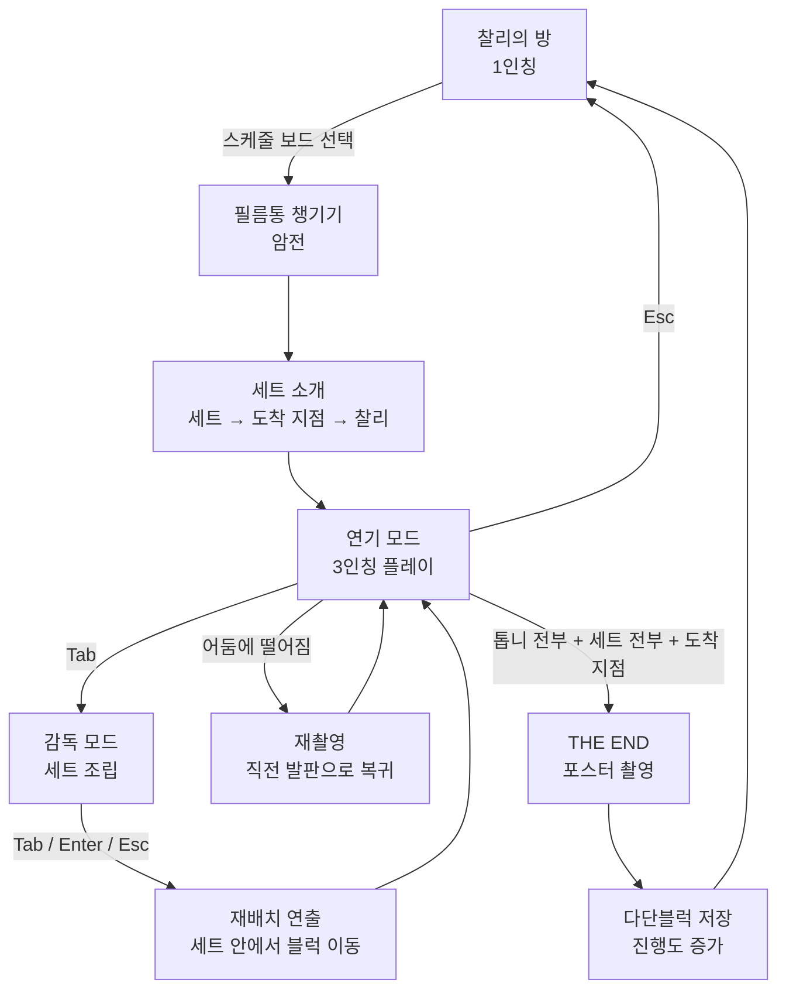
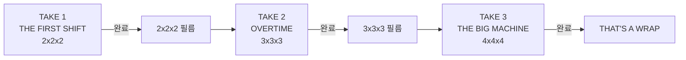

# Director's Cut — 전체 기획서

> 무성영화 시대 공장 세트를 배경으로, **감독이 되어 세트를 조립하고 배우가 되어 그 세트를 달리는** 3D 플랫포머
>
> 출품 대상: 2026 언리얼 메가잼 (주제: Director's Cut)
>
> 핵심 규칙의 자세한 설명은 [핵심 메커니즘 문서](기획서_핵심메커니즘.md)를 참고한다.

---

## 목차
1. [개요](#1-개요)
2. [주제 해석: Director's Cut](#2-주제-해석-directors-cut)
3. [게임 전체 구조](#3-게임-전체-구조)
4. [찰리의 방 (홈)](#4-찰리의-방-홈)
5. [촬영 (스테이지) 흐름](#5-촬영-스테이지-흐름)
6. [세트(씬) 구성](#6-세트씬-구성)
7. [감독 모드 (조립)](#7-감독-모드-조립)
8. [연기 모드 (플레이)](#8-연기-모드-플레이)
9. [모드 전환 연출](#9-모드-전환-연출)
10. [실패와 복귀](#10-실패와-복귀)
11. [촬영 완료 (스테이지 클리어)](#11-촬영-완료-스테이지-클리어)
12. [다단블럭](#12-다단블럭)
13. [진행 구조](#13-진행-구조)
14. [퍼즐 생성 원칙](#14-퍼즐-생성-원칙)
15. [카메라](#15-카메라)
16. [키 바인딩](#16-키-바인딩)
17. [UI / HUD](#17-ui--hud)
18. [아트와 톤](#18-아트와-톤)
19. [오디오 (예정)](#19-오디오-예정)
20. [심사 기준 대응](#20-심사-기준-대응)
21. [잼 범위와 일정](#21-잼-범위와-일정)
22. [IP 유의사항](#22-ip-유의사항)
23. [추후 검토 항목](#23-추후-검토-항목)

---

## 1. 개요

| 항목 | 내용 |
|---|---|
| 장르 | 3D 플랫포머 + 공간 조립 퍼즐 |
| 시점 | 홈은 1인칭, 촬영(플레이)은 3인칭(TPS) |
| 배경 | 무성영화 시대 공장 영화의 촬영장 |
| 주인공 | 찰리 — 공장 노동자 차림의 배우 겸 감독 |
| 핵심 재미 | 내가 조립한 세트를 내가 달린다. 조립이 틀리면 직접 들어가서 몸으로 깨닫고 다시 조립한다 |
| 핵심 장면 | 편집을 마치고 돌아오면 **세트 안에서** 블럭이 빠지고, 옮겨지고, 날아와 끼워진다 |
| 톤 | 장난감 같은 공장 기계 + 무성영화 필름 질감 |

플레이어는 찰리다. 방에서 촬영 스케줄을 확인하고 촬영장에 나가, 빈 세트를 블럭으로 채워 **시작 지점**에서 **도착 지점**까지 가는 길을 만들고, 그 길을 직접 연기(플레이)해서 영화 한 편을 완성한다. 완성한 영화는 다음 촬영의 재료가 된다.

---

## 2. 주제 해석: Director's Cut

| Director's Cut의 의미 | 게임에서 구현된 형태 |
|---|---|
| 감독이 장면을 편집한다 | **감독 모드**에서 세트를 블럭 단위로 잘라 붙인다 |
| 무엇을 넣고 뺄지 결정한다 | 한정된 블럭 중 무엇을 어디에, 어느 방향으로 넣을지가 핵심 선택이다 |
| 수정을 거듭해 완성한다 | 조립 → 연기 → 재조립 반복이 게임 루프 자체다 |
| 나만의 최종판 | 완성한 세트가 그대로 **다단블럭**으로 저장된다. 말 그대로 "내 감독판" |
| 영화 | 촬영 스케줄, 컷/액션, 크레인, THE END, 포스터 등 촬영장 문법으로 전체를 포장 |
| 감독이 곧 주연 | 찰리는 감독 의자에 앉아 편집하고, 세트에 내려가 직접 연기한다 |

용어도 영화 촬영장 기준으로 통일한다.

| 일반 용어 | 게임 내 용어 |
|---|---|
| 스테이지 | 촬영 (TAKE) |
| 맵 | 세트 |
| 편집 모드 | 감독 모드 |
| 플레이 모드 | 연기 모드 |
| 사망 | 재촬영 (RETAKE) |
| 스테이지 클리어 | 촬영 완료 (THE END) |
| 다단블럭 | 찍은 영화 (필름) |

---

## 3. 게임 전체 구조

| 화면 | 시점 | 하는 일 |
|---|---|---|
| 찰리의 방 | 1인칭 | 촬영 선택, 내 모습과 능력 확인, 찍은 영화 보기, 포스터 감상 |
| 연기 모드 | 3인칭 | 세트 안을 직접 달리며 경로 확인, 톱니 수집, 도착 지점 도달 |
| 감독 모드 | 세트를 내려다보는 조립 시점 | 블럭 배치·회수·회전 |

---

## 4. 찰리의 방 (홈)

게임을 켜면 찰리의 방에서 시작한다. 방은 1인칭으로 걸어 다니며 둘러볼 수 있다.

### 4.1 방 구성

| 위치 | 오브젝트 | 상호작용 |
|---|---|---|
| 정면 벽 | **촬영 스케줄 보드** + 아래 책상의 필름통 | 촬영 카드를 누르면 그 촬영을 시작 |
| 오른쪽 벽 | **거울** | 찰리의 현재 모습과 능력 확인 |
| 왼쪽 벽 | **필름 선반** | 찍은 영화(다단블럭)를 3D로 돌려 보기 |
| 뒤쪽 벽 | **포스터 벽** | 완성한 영화의 포스터가 걸림 |
| 기타 | 침대, 의자, 러그, 천장 등 | 분위기용 |

- 처음 켰을 때 시선이 스케줄 보드를 향한다. 실행부터 첫 촬영 시작까지 10초 안쪽을 목표로 한다.
- 가운데 조준점으로 오브젝트를 가리키면 이름과 상태가 표시되고, 클릭하거나 E를 누르면 사용한다.

### 4.2 촬영 스케줄 보드
- 촬영 카드가 촬영 순서대로 붙어 있다.
- 카드 상태

| 상태 | 표시 | 선택 시 |
|---|---|---|
| 완료 | 밝은 초록 톤 + 초록 표시 | 다시 찍기 가능 |
| 다음 촬영 | 빛나는 흰 카드 | 촬영 시작 |
| 아직 아님 | 어두운 회색 + 빨간 표시 | "아직 스케줄에 없음" 안내 |

- 카드에는 촬영 번호, 제목, 세트 크기가 들어간다.

### 4.3 거울
- 거울 앞에 서면 거울 시점으로 바뀌어 찰리의 전신이 보인다.
- 옆에 정보 패널이 뜬다: 이름과 소개(공장 노동자, 배우, 감독), 보유 능력, 완료한 영화 수.
- 능력 도감(옷장)은 능력이 늘어나면 별도 오브젝트로 분리한다. 지금은 거울에 합친다.

### 4.4 필름 선반
- 찍은 영화마다 필름통이 하나씩 놓인다.
- 필름통을 누르면 그 다단블럭을 화면 가득 3D로 띄워 천천히 돌려 보여 준다. 좌우로 다른 필름을 넘겨 본다.
- 아무것도 찍지 않았으면 "아직 찍은 영화 없음"을 안내한다.

### 4.5 포스터 벽
- 촬영을 완료할 때마다 THE END 순간의 세트 전경이 포스터로 찍혀 액자에 걸린다.
- 방이 내 필모그래피로 채워지는 진행감을 준다.
- 다시 찍으면 포스터가 새 결과로 바뀐다.

---

## 5. 촬영 (스테이지) 흐름

### 5.1 출발: 필름통 챙기기
- 스케줄 카드를 누르면 카메라가 책상 쪽으로 내려가고, 찰리가 필름통을 집어 들어 화면 앞으로 가져온다.
- 화면이 암전되며 촬영장으로 넘어간다. 전체 약 1.5초.

### 5.2 세트 소개
화면 위아래에 영화 화면비 띠가 생기고, 카메라가 세 구간을 훑는다. 전체 약 3.8초, 아무 키나 누르면 건너뛴다.

| 구간 | 카메라 | 하단 자막 |
|---|---|---|
| 1 | 세트 바깥 높은 곳에서 세트 전체를 내려다보며 이동 | 세트 |
| 2 | 도착 지점 근처에서 잠시 머무름 | 목적지: 도착 지점 |
| 3 | 찰리 뒤로 내려와 플레이 시점으로 이어짐 | 그리고 주인공 |

- 상단에는 촬영 번호, 제목, 세트 크기가 뜬다.
- 끝나면 "ACTION!" 자막 카드와 함께 연기 모드가 시작된다.

### 5.3 촬영 중 반복
**관찰 → 구상 → 감독 모드에서 조립 → 연기 모드에서 확인 → 재조립**을 반복한다. 감독 모드와 연기 모드는 언제든 오갈 수 있다.

### 5.4 촬영 중단
- 연기 모드에서 Esc를 누르면 방으로 돌아간다. 진행은 저장되지 않는다.

---

## 6. 세트(씬) 구성

### 6.1 기본 형태
- 세트는 정육면체 그리드다. 촬영이 진행될수록 커진다: 2x2x2 → 3x3x3 → 4x4x4.
- 위아래가 있다. 아래층에서 시작해 위층으로 올라가는 구조다.
- 세트의 바깥 테두리는 공장 외벽(세트 벽)이고, **지붕은 열려 있다.**

### 6.2 고정 칸

| 칸 | 위치 | 내용 |
|---|---|---|
| 시작 지점 | 아래층 | 찰리가 여기서 시작 |
| 도착 지점 | 위층 | 촬영의 최종 목표 |

- 각 층 안에서의 정확한 위치는 촬영마다 직접 정한다.
- 두 칸은 편집할 수 없다.

### 6.3 빈 칸 = 어둠
- 처음에는 시작 지점과 도착 지점을 뺀 나머지가 모두 비어 있다.
- 빈 칸은 아무것도 없는 공간이다. 그 너머에 설치한 블럭 내부가 그대로 보인다.
- 빈 칸에 들어가면 재촬영(사망)이다.

### 6.4 항상 보이는 정보
- 허공에 떠 있는 **톱니**, 세트 안의 **멜빵**, **도착 지점** 위치는 어둠과 블럭 너머로도 빛나는 표식으로 항상 보인다.
- 플레이어는 이 표식을 보고 대략적인 경로를 구상한다.

### 6.5 촬영장 (세트 바깥)
- 세트 벽 바깥면은 나무 버팀목이 받치고 있는 **세트 벽 뒷면**이다.
- 세트 주변에 조명 스탠드, 촬영 카메라, 촬영 크레인이 서 있다.
- 크레인은 평소에는 세트 위에 걸려 있고, 감독 모드 전환 때 실제로 움직인다.

---

## 7. 감독 모드 (조립)

### 7.1 화면 구성
- 세트 전체를 축소해 내려다보는 조립 화면.
- 아래쪽에 가진 블럭 목록. 각 칸에 블럭이 현재 회전 상태 그대로 3D로 보인다.
- 세트 밖 모서리에 **감독 의자에 앉아 메가폰을 든 찰리**가 항상 보인다.
- 세트 안에는 연기 모드에서 서 있던 자리에 **멈춰 선 대역 찰리**가 보인다.
- 시작 지점(초록), 도착 지점(밝게 빛남), 톱니(금색 점), 멜빵(파란 점)이 표시된다.
- 아래쪽 화살표가 중력 방향(아래)을 알려 준다.

### 7.2 블럭 단위

| 단위 | 설명 |
|---|---|
| 블럭 | 1x1x1 칸 하나. 독립된 컨셉의 작은 맵 |
| 단블럭 | 블럭 4개 이하가 붙어 있는 조각. 기본 조립 재료 |
| 다단블럭 | 완성한 세트 전체가 하나의 블럭이 된 것 (12장) |

### 7.3 조작

| 동작 | 설명 |
|---|---|
| 배치 | 목록에서 블럭을 골라 빈 칸에 놓는다. 마우스가 가리키는 칸에 블럭이 들어갈 수 있는 위치를 자동으로 찾아 미리 보여 준다(초록 = 가능, 빨강 = 불가) |
| 회수 | 놓은 블럭을 우클릭하거나, 목록에서 배치된 블럭을 클릭하면 목록으로 돌아온다 |
| 회전 | 24방향 모두 가능. 화면 기준 축으로 돌린다 (세로축 / 화면 오른쪽 축 / 화면 앞쪽 축) |
| 선택 | 목록 클릭, 숫자키, 이전/다음 |
| 전부 회수 | 놓은 블럭을 한 번에 모두 회수 |
| 시점 | 우클릭 드래그로 돌려 보고 휠로 확대·축소 |

### 7.4 회전하면 안의 맵도 회전한다
- 블럭을 돌려서 넣으면 그 블럭 안의 맵도 똑같이 돌아간다.
- 바닥이 옆을 보게 넣으면 그 블럭의 바닥은 벽이 되고, 계단은 옆으로 눕는다.
- 같은 블럭이라도 **어디에, 어느 방향으로** 넣느냐에 따라 길이 완전히 달라진다.

### 7.5 보여 주는 것 / 숨기는 것
- **보여 준다**: 블럭 종류(색), 그 블럭의 바닥 방향(어두운 판), 톱니·멜빵·찰리 위치
- **숨긴다**: 블럭 안의 발판 배치, 블럭끼리 발판이 이어지는지
- 숨기는 이유: 직접 들어가 확인하고 다시 편집하는 시행착오가 곧 플레이이기 때문

### 7.6 외면 / 내면 규칙
- 블럭의 각 면은 세트 안에 놓인 위치에 따라 외면이 되거나 내면이 된다.
- **내면(세트 안쪽)에는 벽이 없다.** 이웃한 블럭들은 하나의 큰 공간으로 이어진다.
- **외면(세트 테두리)만 벽이다.**
- 블럭 사이를 오가는 건 벽이 아니라 **발판이 이어지느냐**로 결정된다.
  - 옆 블럭: 맞닿은 쪽 발판이 이어지면 건널 수 있다.
  - 위 블럭: 아래 블럭의 오르막 끝 바로 위에 위 블럭 바닥의 구멍이 있어야 올라갈 수 있다.
  - 아래 블럭: 바닥 구멍으로 떨어져 내려갈 수 있다.

### 7.7 서 있는 블럭도 편집 가능
- 플레이어가 지금 서 있는 블럭도 옮기거나 돌리거나 뺄 수 있다.
- 옮기거나 돌리면 찰리도 그 블럭에 실려 함께 이동한다.
- 빼 버리면 찰리도 함께 어둠으로 떨어진다(10장).

### 7.8 감독 모드 진입 시점
- 연기 모드 중이면 **언제든** 들어갈 수 있다.
- 단, 세트 소개·크레인 연출·재배치 연출·THE END 중에는 들어갈 수 없다.

---

## 8. 연기 모드 (플레이)

### 8.1 플레이어 능력
현재는 두 가지이고, 이후 추가할 예정이다.

| 능력 | 설명 |
|---|---|
| **점프** | 기본 이동 수단. 달리면서 착지 직후 다시 뛰면 점점 높이 뛴다(최대 3단, 3단째는 공중제비) |
| **멜빵 (스패너)** | 세트 안의 멜빵을 얻으면 스패너를 쓸 수 있다. 다단블럭의 잠긴 패널 나사를 푼다(12장) |

- 그 밖의 이동은 플레이어 능력이 아니라 **블럭 안의 기믹**으로 해결한다.

### 8.2 수집과 목표
- **톱니**: 세트 허공에 떠 있는 수집 아이템. 모두 모아야 도착 지점에서 촬영을 끝낼 수 있다.
- **멜빵**: 다단블럭을 쓸 수 있는 촬영에만 놓인다. 그 촬영 안에서만 유효하다.
- **도착 지점**: 위층에 있는 최종 목표.

---

## 9. 모드 전환 연출

감독 모드는 자주 오가므로 **긴 연출은 한 번, 그다음은 짧게**가 원칙이다. 처음 한 번 길게 보여 줘서 "감독도 찰리다"를 각인시키고, 이후의 인식은 감독 화면에 항상 보이는 찰리(의자에 앉은 찰리, 대역 찰리)가 유지한다.

### 9.1 자막 카드
- 무성영화식 검은 자막 카드에 장식 테두리와 큰 글씨.
- 감독 모드 진입: **"CUT!"**
- 연기 모드 복귀, 세트 소개 끝: **"ACTION!"**

### 9.2 연기 → 감독

| 상황 | 연출 | 길이 |
|---|---|---|
| 그 촬영에서 처음 들어갈 때 | "CUT!" → 세트 밖 크레인 팔이 열린 지붕으로 내려와 찰리 옆에 의자를 내림 → 찰리가 앉음 → 크레인이 찰리를 태우고 지붕 위로 올라감 → 카메라가 세트 전체를 내려다보는 감독 시점으로 이어짐 | 약 2.8초 |
| 두 번째부터 | "CUT!"과 함께 카메라가 지붕 위로 빠르게 올라가 감독 시점이 됨 | 약 0.4초 |

- 크레인 연출 동안 카메라는 세트 가운데 쪽에서 찰리를 바라보다가, 올라가는 의자를 따라간다.
- 화면 위아래에 영화 화면비 띠가 생긴다.

### 9.3 감독 → 연기: 재배치 연출
편집을 마치면 "ACTION!" 카드와 함께, **세트 안에서** 바뀐 내용이 실제로 일어나는 장면을 보여 준다.

1. 카메라가 살짝 물러나며 세트 가운데를 향한다.
2. **빠지는 블럭**이 회전하며 어둠 속으로 날아가 사라진다.
3. **옮긴 블럭**이 하나씩 호를 그리며 새 자리로 이동하고 회전한다.
4. **새 블럭**이 바깥에서 회전하며 날아와 하나씩 끼워진다.
5. 끝나면 카메라가 찰리 뒤로 돌아오고 조작이 재개된다.

- **바뀐 블럭만** 움직인다. 바뀐 게 없으면 바로 돌아온다.
- 바뀐 양이 많으면 전체 속도를 올려 **최대 2초**로 맞춘다.
- 건너뛰기 키로 바로 끝낼 수 있고, 연출 중에도 시점은 돌릴 수 있다.
- 서 있던 블럭이 움직이면 찰리도 함께 실려 간다. 플레이어 주변에서 세계가 재조립되는 장면(인셉션 같은 느낌)이 핵심이다.

---

## 10. 실패와 복귀

| 상황 | 처리 |
|---|---|
| 빈 칸(어둠)에 들어감 | 재촬영 → 떨어지기 직전에 밟고 있던 발판으로 복귀 |
| 복귀 지점의 블럭이 편집으로 옮겨짐 | 옮겨진 블럭의 같은 자리로 복귀 |
| 복귀 지점의 블럭이 편집으로 빠짐 | 시작 지점으로 복귀 |
| 서 있던 블럭을 편집으로 뺌 | 재배치 연출 때 블럭과 함께 어둠으로 날아간 뒤 위 규칙대로 복귀 |
| 직접 원할 때 | 시작 지점으로 즉시 복귀 가능 |

- 복귀 지점은 "그 블럭 안의 위치"로 기억한다. 그래서 블럭이 다른 곳으로 옮겨져도 정확히 그 발판으로 돌아간다.
- 재촬영 시 화면이 잠깐 번쩍이고, 재촬영 횟수(RETAKES)가 기록된다.
- 페널티는 가볍다. 빠르게 돌아와서 마음껏 시험하고 다시 조립하게 하는 것이 목적이다.

---

## 11. 촬영 완료 (스테이지 클리어)

### 11.1 완료 조건
아래 세 가지를 모두 충족해야 한다.
1. 세트의 **톱니를 모두** 모은다.
2. 세트의 **모든 칸을 블럭으로 채운다.** (빈 칸이 하나도 없어야 한다)
3. **도착 지점**에 닿는다.

조건이 덜 채워진 상태로 도착 지점에 가면 무엇이 부족한지 알려 준다("톱니를 먼저 모두 모으세요" / "세트를 먼저 모두 채우세요").

### 11.2 THE END 연출
1. 화면 위아래에 영화 화면비 띠가 생기고 **"THE END"**가 크게 뜬다.
2. 아래에 "(영화 제목) - A FILM BY CHARLIE", "이 세트가 다단블럭으로 저장됨" 안내가 나온다.
3. 카메라가 세트 위를 천천히 돌며 전경을 보여 준다. 카메라를 가리는 세트 벽은 반투명해진다.
4. 이 전경이 **포스터**로 찍힌다.
5. 확인 키나 클릭으로 방으로 돌아간다.

### 11.3 완료 보상
- 완성한 세트 전체가 **다단블럭**으로 저장되어 필름 선반에 필름통으로 놓인다.
- 포스터가 포스터 벽에 걸린다.
- 스케줄 보드의 다음 촬영이 열린다.
- 방으로 돌아오면 "FILM WRAPPED: (제목)" 안내가 뜬다.

---

## 12. 다단블럭

### 12.1 정의
- 완성한 세트 전체가 하나의 정육면체 블럭이 된 것. 2x2x2 세트를 완성하면 2x2x2 다단블럭이 된다.
- 안에는 내가 조립한 배치, 각 블럭의 회전, 시작 지점과 도착 지점까지 그대로 들어 있다. (다단블럭 안의 도착 지점은 장식이며 목표가 아니다.)
- 다른 블럭처럼 24방향으로 회전해서 넣을 수 있고, 돌리면 안의 세트 전체가 함께 돌아간다.
- 같은 촬영을 다시 찍으면 그 촬영의 다단블럭은 새 결과로 바뀐다.

### 12.2 껍데기와 잠긴 패널
- 다단블럭은 원래 세트였기 때문에 바깥 껍데기가 있다.
- 다른 세트에 끼워 넣었을 때 껍데기 면이
  - **새 세트의 테두리**를 향하면: 세트 외벽과 합쳐져 그냥 벽이 된다.
  - **새 세트의 안쪽**을 향하면: **나사 4개로 잠긴 패널**이 된다.
- 잠긴 패널은 단단한 면이라 **발판이나 벽으로 쓸 수 있다.**

### 12.3 멜빵으로 패널 열기
- 세트 안 어딘가에 있는 **멜빵**을 얻으면 스패너를 쓸 수 있다. 찰리 외형에도 빨간 멜빵과 손의 스패너가 나타난다.
- 패널 꼭짓점의 나사 근처에서 상호작용하면 나사가 하나씩 풀린다.
- 한 면의 나사 4개를 모두 풀면 그 패널이 열리고, 다단블럭 안을 탐방할 수 있다.
- 스패너는 **그 촬영 안에서만** 유효하다. 다음 촬영에서는 다시 멜빵을 찾아야 한다.
- 멜빵 없이 패널에 다가가면 "멜빵이 필요하다"고 안내한다.

### 12.4 다단블럭을 쓰는 이유
- **꼭 써야 하는 촬영**: 블럭이 모자라서 다단블럭 없이는 세트를 다 채울 수 없다.
- **선택해서 쓰는 촬영**: 다단블럭 안의 구조가 이번 경로에 효율적이면 쓰는 게 이득이다. 대신 그만큼 다른 블럭이 남는다.
- 다단블럭은 "닫힌 채 지형으로 쓸지, 열어서 안의 경로를 쓸지"를 고르는 선택지이기도 하다.

---

## 13. 진행 구조

| 촬영 | 제목 | 세트 | 톱니 | 다단블럭 | 역할 |
|---|---|---|---|---|---|
| TAKE 1 | THE FIRST SHIFT | 2x2x2 | 1개 | 없음 | 조립·회전·연기의 기본을 익힌다 |
| TAKE 2 | OVERTIME | 3x3x3 | 2개 | 2x2x2 필름 **필수** + 멜빵 | 내가 만든 세트를 다음 세트의 재료로 쓴다 |
| TAKE 3 | THE BIG MACHINE | 4x4x4 | 3개 | 3x3x3 필름 **선택** + 멜빵 | 큰 세트에서 선택과 우회를 모두 요구한다 |

- 다단블럭은 지금 세트보다 작은 것 중 가장 큰 것이 인벤토리에 들어온다.
- 모든 촬영을 마치면 방에 "ALL FILMS WRAPPED - THAT'S A WRAP!"이 뜬다.
- 완료한 촬영은 언제든 다시 찍을 수 있다.

---

## 14. 퍼즐 생성 원칙

- 촬영마다 **정답 배치를 먼저 만들고**, 그 정답을 이루는 블럭들을 무작위로 회전시켜 인벤토리로 준다. 그래서 모든 촬영에는 적어도 하나의 정답이 있다.
- 정답 배치를 만드는 순서
  1. 시작 지점과 도착 지점을 고정한다.
  2. 다단블럭이 필수인 촬영이면, 고정 칸과 겹치지 않는 자리에 다단블럭을 먼저 놓는다.
  3. 남은 칸을 4칸 이하 단블럭으로 나눈다. 이웃이 적은 칸부터 조각을 키워 외톨이 칸을 줄인다.
  4. 각 블럭에 컨셉을 배정한다.
- 정답 배치에서 **시작 지점 → 도착 지점까지 실제로 갈 수 있는지**를 블럭 바닥 타일과 오르막 끝 위치로 단순화한 모델로 검사한다. 갈 수 없으면 다시 만든다.
- 톱니와 멜빵은 정답 배치 기준으로 **도달 가능한 블럭** 안의 자리에만 놓는다.
- 잼 출품판은 무작위 생성 대신 **손으로 설계한 촬영**으로 바꾸는 것을 검토한다(21장).

---

## 15. 카메라

| 상황 | 카메라 |
|---|---|
| 찰리의 방 | 1인칭 |
| 연기 모드 | 3인칭. 찰리 어깨 뒤, 휠로 거리 조절 |
| 감독 모드 | 세트 전체를 내려다보는 조립 시점. 드래그로 회전, 휠로 확대 |
| 짧은 감독 전환 | 지붕 위 높은 곳에서 세트 가운데를 내려다봄 |
| 세트 소개 / 크레인 / THE END | 연출 경로를 따라 자동 이동 |

- **카메라는 벽에 밀려 확대되지 않는다.** 항상 정해진 거리를 유지한다.
- 대신 카메라와 찰리(또는 연출의 초점) 사이를 가리는 오브젝트는 잠시 **반투명**해지고, 벗어나면 다시 불투명해진다.
- 카메라는 땅 아래로 내려가지 않는다.

---

## 16. 키 바인딩

현재 프로토타입 기준.

### 16.1 찰리의 방
| 입력 | 동작 |
|---|---|
| W A S D | 이동 |
| 마우스 | 시점 |
| Shift | 달리기 |
| Space | 점프 |
| 좌클릭 / E / Enter | 가리킨 오브젝트 사용 (스케줄 보드, 거울, 필름 선반) |
| A·D / ←·→ | 필름 선반 보기 중 다른 필름으로 넘기기 |
| Esc / E / Enter / 좌클릭 | 거울·필름 선반 보기 닫기 |
| Esc | 게임 종료 (보기 화면이 아닐 때) |

### 16.2 연기 모드
| 입력 | 동작 |
|---|---|
| W A S D | 이동 |
| 마우스 | 시점 |
| 휠 | 카메라 거리 |
| Shift | 달리기 |
| Space | 점프 (달리며 착지 직후 다시 누르면 연속 점프, 최대 3단) |
| Tab | 감독 모드로 (CUT!) |
| E | 나사 풀기 (멜빵 보유 시) |
| R | 시작 지점으로 복귀 |
| Esc | 촬영 중단, 방으로 |

**블럭 기믹 조작**
| 입력 | 동작 |
|---|---|
| Space / Ctrl(또는 C) | 증기 승강기 안에서 상승 / 하강 |
| W / S | 사다리에서 오르기 / 내리기 |

**연출 중**
| 입력 | 동작 |
|---|---|
| 아무 키 / 좌클릭 | 세트 소개 건너뛰기 |
| Space / Enter / E / 좌클릭 | 재배치 연출 건너뛰기 |
| Enter / Space / 좌클릭 | THE END 화면에서 방으로 (잠시 뒤 가능) |

### 16.3 감독 모드
| 입력 | 동작 |
|---|---|
| 좌클릭 (세트) | 선택한 블럭 배치 |
| 좌클릭 (목록) | 블럭 선택 / 배치된 블럭이면 회수 |
| 우클릭 (세트) | 놓은 블럭 회수 |
| 우클릭 드래그 | 조립 화면 회전 |
| 휠 | 확대·축소 |
| Q / E | 세로축 회전 |
| W / S | 화면 오른쪽 축 회전 |
| A / D | 화면 앞쪽 축 회전 |
| 1 ~ 9 | 목록의 블럭 바로 선택 |
| Z / X | 이전 / 다음 블럭 |
| Backspace | 전부 회수 |
| F5 | 자동 풀이 (테스트용) |
| Tab / Enter / Esc | 연기 모드로 (ACTION!) |

### 16.4 공통
| 입력 | 동작 |
|---|---|
| F1 | 필름 효과 켜기/끄기 |

---

## 17. UI / HUD

### 17.1 찰리의 방
- 좌상단: "CHARLIE'S ROOM", 완료한 영화 수
- 가운데: 조준점, 가리킨 오브젝트 이름과 상태
- 아무것도 가리키지 않을 때: "촬영 스케줄은 보드에 있다" 안내

### 17.2 연기 모드
- 좌상단: 촬영 번호·제목·세트 크기, 톱니 아이콘과 개수, 채운 칸 수, 멜빵 상태
- 상단 가운데: 지금 있는 블럭 이름
- 상황 안내: 기믹 조작법, 나사 풀기 가능 여부, 재배치 중
- 하단: 재촬영 횟수, 조작 요약
- 촬영 시작 직후 몇 초간 기본 조작 도움말

### 17.3 감독 모드
- 좌상단: "DIRECTOR MODE - (제목)", 톱니·채운 칸·멜빵 상태, 선택한 블럭 정보
- 우상단: 조작 요약, 표시 범례(바닥 판, 시작·도착 지점, 톱니·멜빵·찰리 점)
- 하단: 블럭 목록 (배치한 블럭은 어둡게 + 배치됨 표시, 다단블럭은 파란 테두리)

### 17.4 연출 화면
- 세트 소개 / 크레인 / THE END: 영화 화면비 띠
- 자막 카드: CUT! / ACTION!
- 안내 문구(토스트): 톱니 획득, 멜빵 획득, 패널 열림, 조건 부족, 영화 완료 등

---

## 18. 아트와 톤

- **무성영화 필름**: 세피아 톤, 대비 강조, 화면 깜빡임, 세로 스크래치, 먼지, 비네트. 켜고 끌 수 있다.
- **잉크 외곽선**: 모든 오브젝트에 손그림 같은 검은 외곽선.
- **장난감 공장**: 통통하고 단순한 기계 형태, 끝없이 돌아가는 톱니와 볼트, 뿜어져 나오는 증기.
- **블럭 구분**: 블럭마다 고유 색. 바닥 가장자리에 그 블럭 색의 띠를 둘러 벽이 없어도 경계를 알 수 있게 한다.
- **조명**: 지붕 없는 세트에 위에서 내리쬐는 빛과 그림자, 찰리 주변을 밝히는 작은 조명. 세트 밖은 어두운 촬영장.
- **찰리**: 중절모와 작업복 차림. 멜빵을 얻으면 빨간 멜빵과 스패너가 보인다. 감독 모드에서는 감독 의자와 메가폰.

---

## 19. 오디오 (예정)

현재 프로토타입에는 소리가 없다. 언리얼 단계에서 아래를 넣는다.

| 종류 | 내용 |
|---|---|
| 음악 | 무성영화풍 피아노/래그타임 BGM. 방, 촬영, THE END 각각 |
| 연출 효과음 | 클래퍼보드, "CUT!" / "ACTION!", 크레인 모터, 필름 영사기 소리 |
| 재배치 | 블럭이 빠지고 끼워지는 기계음, 철컥 소리 |
| 플레이 | 발소리, 점프, 착지, 톱니 획득, 나사 풀기, 재촬영 |
| 세트 | 블럭별 환경음 |

---

## 20. 심사 기준 대응

| 심사 기준 | 대응 |
|---|---|
| 야망과 혁신 | 세트 안에 있으면서 세트를 재편집하고, 그게 눈앞에서 재조립되는 메커니즘. 완성한 세트가 다음 세트의 재료가 되는 구조 |
| 주제 | 감독 모드 = 편집, 연기 모드 = 연기, 완성한 세트 = 내 감독판. 촬영장 문법으로 전체 포장 |
| 재미 요소 | 빠른 조립 ↔ 연기 전환, 가벼운 재촬영, 연속 점프의 손맛 |
| 게임플레이 | 회전하면 안의 맵도 돈다는 독창적 규칙, 발판 연결을 직접 확인하는 시행착오 |
| 비주얼 | 무성영화 필름 + 장난감 공장 + 잉크 외곽선으로 일관된 양식 |
| 레벨 디자인 및 진행 | 세트 소개로 목적지 안내, 항상 보이는 표식, 2→3→4 진행과 다단블럭 재사용 |
| 오디오 | 19장 계획 (가장 적은 노력으로 점수를 올릴 수 있는 항목) |

---

## 21. 잼 범위와 일정

개발 기간이 나흘이라 범위를 나눈다.

### 21.1 반드시 넣을 것
- 그리드 조립(배치·회수·24방향 회전)
- 세트 안 재배치 연출 (핵심)
- 직접 설계한 블럭 5~6종, 오르는 방식이 확실히 다르게
- 직접 설계한 촬영 2~3편
- 톱니 수집, 도착 지점, 재촬영 복귀
- 완성한 세트를 다음 촬영에서 다단블럭으로 쓰기
- 찰리의 방(스케줄 보드 중심), 세트 소개, CUT!/ACTION!, THE END
- 필름 효과, BGM과 효과음

### 21.2 시간이 남으면
- 크레인 첫 진입 연출 (없으면 짧은 전환으로 대체)
- 다단블럭 패널 + 멜빵
- 거울, 필름 선반, 포스터 벽
- 4x4x4 촬영

### 21.3 나흘 배분 예시
| 날짜 | 작업 |
|---|---|
| 1일차 | 그리드, 블럭 액터, 감독 모드 UI, 회전 |
| 2일차 | 연기 모드 이동, 재배치 연출, 재촬영 복귀 |
| 3일차 | 블럭 제작, 촬영 설계, 다단블럭 재사용, 찰리의 방 |
| 4일차 | 연출(소개·컷/액션·THE END), 필름 효과, 오디오, 빌드와 출품 |

### 21.4 확인할 것
- 기존 코드·에셋 사용 가능 여부: 현재 OpenGL 프로토타입은 **기획 검증용 참고**로만 쓰고 언리얼에서 새로 만든다.
- 잼 규정의 IP 조항 (22장)

---

## 22. IP 유의사항

- 〈모던 타임즈〉 제목, 채플린 이름, 영화 장면·음악·스틸컷은 사용하지 않는다.
- 떠돌이 캐릭터를 그대로 재현하지 않는다(콧수염 + 지팡이 + 뒤뚱걸음 조합 등).
- 무성영화 시대 공장, 톱니, 컨베이어, 세피아 필름 톤 같은 장르적 분위기는 오마주 범위로 사용한다.
- 주인공 이름 "찰리"와 저장소 이름은 출품 전에 유지 여부를 다시 검토한다. 이름이 채플린을 강하게 떠올리게 하므로, 가상의 무성영화풍 이름으로 바꾸는 안도 고려한다.

---

## 23. 추후 검토 항목

- 점프·멜빵 이후 추가할 플레이어 능력과 옷장(능력 도감) 분리
- 촬영별 시작 지점·도착 지점의 정확한 위치 설계
- 4x4x4보다 큰 세트 도입 여부
- 다단블럭이 여러 개 쌓였을 때의 인벤토리 운용 (어떤 필름을 가져갈지 고르기)
- 촬영별 난이도 곡선, 톱니 개수, 손으로 설계한 촬영으로의 전환
- 완료 기록(재촬영 횟수, 편집 횟수, 시간)에 따른 평가와 포스터 등급
- 완성한 영화 리플레이 상영 (방에서 필름통으로 감상)
- 크레인 연출 중 자막 카드가 찰리를 가리지 않게 배치 조정
