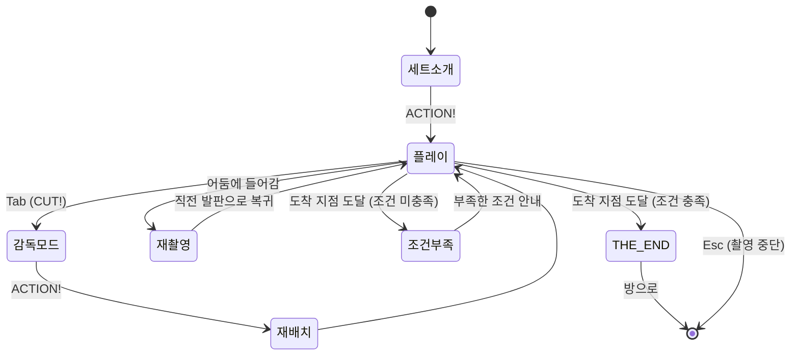
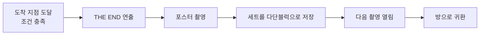

# 3인칭 플랫포머 · 목표 · 클리어 기획서

> 조립한 세트 안을 직접 달리는 **연기 모드** 기능 명세.
> 3인칭 이동과 점프(2단 점프), 목표와 조건, 실패와 복귀, 촬영 완료 과정까지 다룬다.
> 블럭 내부 지형과 기믹은 레벨 디자인이 정해진 뒤 **차후 후술**한다.
>
> 짝 문서: [씬 조립 기능 기획서](기획서_씬조립.md)

---

## 1. 범위

| 포함 | 제외 (차후 후술) |
|---|---|
| 3인칭 캐릭터 이동 | 블럭 내부 지형·기믹 (승강기, 사다리 등) |
| 점프와 2단 점프 | 추가 플레이어 능력 |
| 3인칭 카메라 | 촬영별 톱니 위치와 개수 |
| 목표 오브젝트 (톱니, 멜빵, 도착 지점) | 촬영별 시작·도착 지점의 정확한 위치 |
| 촬영 완료 조건과 클리어 과정 | 이동·점프 수치의 최종 튜닝 |
| 실패(어둠)와 복귀 | |
| 다단블럭 패널 열기 (멜빵) | |
| 연기 모드 HUD와 조작 | |

---

## 2. 연기 모드 상태 흐름

| 상태 | 조작 가능 | 설명 |
|---|---|---|
| 세트 소개 | 건너뛰기만 | 세트 → 도착 지점 → 찰리 순으로 카메라가 훑음 |
| 플레이 | 전부 | 이동, 점프, 상호작용, 감독 모드 진입 |
| 재배치 | 시점, 건너뛰기 | 조립 결과가 세트 안에서 반영되는 연출 |
| 재촬영 | 없음 (즉시) | 화면이 번쩍이고 직전 발판으로 복귀 |
| THE END | 확인만 | 촬영 완료 연출 |

---

## 3. 캐릭터 이동

### 3.1 기본 이동
- WASD 입력 방향은 **카메라 기준**이다. 카메라가 보는 방향이 앞이다.
- 캐릭터는 이동 방향으로 부드럽게 몸을 돌린다.
- 걷기와 달리기(Shift) 두 속도.
- 땅에서는 빠르게 가속·감속하고, 공중에서는 약하게 방향을 바꿀 수 있다(공중 제어).

### 3.2 지형 처리
- 낮은 단차는 점프 없이 그대로 걸어 올라간다.
- 벽에 부딪히면 벽을 따라 미끄러진다.
- 머리 위가 막혀 있으면 점프가 거기서 멈춘다.
- 움직이는 바닥(컨베이어 등) 위에 서 있으면 함께 실려 간다.

### 3.3 착지
- 높은 곳에서 떨어져 착지하면 몸이 살짝 눌리는 반응이 있다.
- 낙하 피해는 없다. 실패는 어둠에 들어갈 때만 일어난다.

---

## 4. 점프

### 4.1 1단 점프
- 땅에 서 있을 때 Space를 누르면 점프한다.

### 4.2 2단 점프
- 공중에서 Space를 한 번 더 누르면 **공중에서 한 번 더** 뛴다.
- 2단 점프는 땅에 닿기 전까지 한 번만 쓸 수 있다.
- 땅에 착지하면 다시 쓸 수 있게 된다.
- 점프하지 않고 발판에서 떨어진 경우에도 공중에서 한 번 뛸 수 있다. (발판 끝에서 늦게 눌러도 살아날 여지)
- 2단 점프 때는 공중제비 동작으로 1단과 구분되게 보인다.

### 4.3 점프 손맛 보조 (권장)
| 장치 | 설명 |
|---|---|
| 코요테 타임 | 발판 끝을 막 벗어난 아주 짧은 순간에는 땅 점프로 인정 |
| 점프 입력 버퍼 | 착지 직전에 누른 점프도 착지 순간 실행 |
| 가변 점프 높이 | 짧게 누르면 낮게, 길게 누르면 높게 (선택) |

### 4.4 튜닝 항목

| 항목 | 기준 |
|---|---|
| 1단 점프 높이 | 블럭 안 일반 발판 한 단을 넘을 수 있는 높이 |
| 2단 점프까지 합친 최대 높이 | 블럭 안 "어려운 단차"의 기준 |
| 최대 수평 점프 거리 | 발판 사이 간격 설계의 기준 |
| 걷기 / 달리기 속도 | |
| 공중 제어 세기 | |
| 중력 | |

- 위 값들은 레벨 디자인의 기준이 되므로, 블럭 내부 설계 전에 먼저 확정한다.

---

## 5. 카메라

- 3인칭. 찰리 어깨 뒤에서 바라본다.
- 마우스로 돌리고, 휠로 거리를 조절한다.
- **벽에 밀려 확대되지 않는다.** 항상 정해진 거리를 유지한다.
- 카메라와 찰리 사이를 가리는 오브젝트는 잠시 **반투명**해지고, 벗어나면 다시 불투명해진다.
- 카메라는 땅 아래로 내려가지 않는다.

---

## 6. 목표 오브젝트

| 오브젝트 | 역할 | 획득 방법 | 비고 |
|---|---|---|---|
| **톱니** | 수집 아이템. 촬영 완료 조건 | 닿으면 획득 | 세트 허공에 떠 있음 |
| **멜빵** | 능력 아이템 (스패너) | 닿으면 획득 | 다단블럭을 쓸 수 있는 촬영에만 존재. 그 촬영 안에서만 유효 |
| **도착 지점** | 최종 목표 | 닿으면 완료 판정 | 위층 고정 칸 안 |

### 6.1 항상 보이는 표식
- 톱니, 멜빵, 도착 지점은 어둠과 블럭 너머로도 빛나는 표식으로 **항상 보인다.**
- 표식은 회전하며 빛나고, 톱니와 멜빵은 색으로 구분한다.
- 조건을 모두 채우면 도착 지점 표식의 색이 바뀌어 "이제 갈 수 있다"를 알린다.

### 6.2 획득 피드백
- 화면이 짧게 번쩍이고 불꽃이 튄다.
- 톱니: "톱니 n / 전체" 안내.
- 멜빵: "멜빵 획득 - 스패너 사용 가능" 안내. 찰리 외형에 빨간 멜빵과 손의 스패너가 나타난다.

---

## 7. 멜빵: 다단블럭 패널 열기

- 다단블럭의 껍데기 중 세트 안쪽을 향하는 면은 **나사 4개로 잠긴 패널**이다. (생성 규칙은 [씬 조립 기획서](기획서_씬조립.md) 8장)
- 닫힌 패널은 단단한 면이라 발판이나 벽으로 쓸 수 있다.
- 나사 가까이에서 상호작용(E)하면

| 멜빵 | 결과 |
|---|---|
| 있음 | 가장 가까운 나사 하나가 풀린다 |
| 없음 | "멜빵이 필요하다" 안내 |

- 한 면의 나사 4개를 모두 풀면 그 패널이 사라지고 다단블럭 안으로 들어갈 수 있다.
- 나사 근처에 가면 화면에 상호작용 안내가 뜬다.

---

## 8. 실패와 복귀

### 8.1 실패 조건
- **빈 칸(어둠)에 들어가면** 재촬영(사망)이다.
- 세트 아래로 떨어진 경우도 재촬영이다.
- 그 외의 피해·체력은 없다.

### 8.2 복귀 위치

| 상황 | 복귀 위치 |
|---|---|
| 기본 | 떨어지기 직전에 밟고 있던 발판 |
| 그 발판의 블럭이 편집으로 옮겨짐 | 옮겨진 블럭 안의 같은 발판 |
| 그 발판의 블럭이 편집으로 빠짐 | 시작 지점 |
| 수동 복귀 (R) | 시작 지점 |

- "직전 발판"은 움직이지 않는 일반 바닥만 기억한다. 움직이는 바닥이나 튕기는 발판 위는 기억하지 않는다.
- 복귀 지점은 세계 좌표가 아니라 **"어느 블럭의 어느 자리"**로 기억한다. 그래서 편집으로 블럭이 움직여도 정확히 따라간다.

### 8.3 피드백
- 화면이 짧게 번쩍이고 즉시 복귀한다.
- 재촬영 횟수(RETAKES)가 HUD에 기록된다.
- 페널티는 가볍게 유지한다. 빨리 돌아와서 다시 시험하게 하는 것이 목적이다.

---

## 9. 촬영 완료 조건

아래 세 가지를 모두 충족해야 한다.

| 순서 | 조건 | 확인 |
|---|---|---|
| 1 | 세트의 **톱니를 모두** 모은다 | HUD 톱니 개수 |
| 2 | 세트의 **모든 칸을 블럭으로 채운다** | HUD 채운 칸 수 (판정은 [씬 조립 기획서](기획서_씬조립.md) 10장) |
| 3 | **도착 지점**에 닿는다 | 도착 판정 |

### 9.1 조건이 덜 채워진 채 도착했을 때
| 부족한 것 | 안내 |
|---|---|
| 톱니 | "톱니를 먼저 모두 모으세요" |
| 빈 칸 | "세트를 먼저 모두 채우세요" |

- 안내 후 그대로 플레이를 계속한다. 도착 지점에서 밀어내거나 되돌리지 않는다.

---

## 10. 클리어 과정

1. **도착**: 조건을 모두 채운 상태로 도착 지점에 닿으면 즉시 조작이 멈춘다.
2. **THE END 연출**
   - 화면 위아래에 영화 화면비 띠가 생긴다.
   - "THE END"가 크게 뜨고, 아래에 영화 제목과 "이 세트가 다단블럭으로 저장됨" 안내.
   - 카메라가 세트 위를 천천히 돌며 전경을 보여 준다. 가리는 세트 벽은 반투명해진다.
3. **포스터 촬영**: 연출이 시작되고 잠시 뒤의 세트 전경을 포스터로 저장한다.
4. **저장**: 완성한 세트를 다단블럭으로 저장한다. 같은 촬영을 다시 찍었으면 새 결과로 바꾼다.
5. **진행**: 다음 촬영이 열린다.
6. **귀환**: 잠시 뒤 확인 입력(Enter / Space / 클릭)으로 방으로 돌아가고, "영화 완료: (제목)" 안내가 뜬다.

### 10.1 촬영 중단
- 플레이 중 Esc를 누르면 방으로 돌아간다.
- 이때는 저장도, 진행도 없다.

---

## 11. 연기 모드 HUD

| 위치 | 내용 |
|---|---|
| 좌상단 | 촬영 번호·제목·세트 크기 |
| 좌상단 아래 | 톱니 아이콘(획득/미획득)과 개수, 채운 칸 수 / 전체, 멜빵 상태 |
| 상단 가운데 | 지금 있는 블럭 이름 |
| 화면 가운데 | 상황 안내 (나사 풀기 가능 여부, 기믹 조작법, 재배치 중) |
| 화면 가운데 위 | 안내 문구 (톱니·멜빵 획득, 조건 부족 등) |
| 좌하단 | 재촬영 횟수 |
| 우하단 | 조작 요약 |
| 촬영 시작 직후 | 기본 조작 도움말 (몇 초 뒤 사라짐) |

---

## 12. 키 바인딩 (연기 모드)

| 입력 | 동작 |
|---|---|
| W A S D | 이동 (카메라 기준) |
| 마우스 | 시점 |
| 휠 | 카메라 거리 |
| Shift | 달리기 |
| Space | 점프 / 공중에서 한 번 더 누르면 2단 점프 |
| E | 상호작용 (나사 풀기) |
| R | 시작 지점으로 복귀 |
| Tab | 감독 모드로 (CUT!) |
| Esc | 촬영 중단, 방으로 |

**연출 중**
| 입력 | 동작 |
|---|---|
| 아무 키 / 좌클릭 | 세트 소개 건너뛰기 |
| Space / Enter / E / 좌클릭 | 재배치 연출 건너뛰기 |
| Enter / Space / 좌클릭 | THE END에서 방으로 (잠시 뒤 가능) |

- 블럭 기믹 전용 조작은 기믹이 정해진 뒤 추가한다.

---

## 13. 구현 확인 항목

- [ ] 이동 방향이 항상 카메라 기준이다
- [ ] 낮은 단차는 걸어서 오르고, 벽에서는 미끄러진다
- [ ] 1단 점프 후 공중에서 한 번만 더 뛸 수 있고, 착지하면 다시 쓸 수 있다
- [ ] 발판에서 걸어 떨어진 뒤에도 공중 점프가 한 번 된다
- [ ] 카메라가 벽에 밀려 들어오지 않고, 가리는 물체가 반투명해진다
- [ ] 톱니·멜빵·도착 지점 표식이 벽과 어둠 너머로도 보인다
- [ ] 어둠에 들어가면 직전 발판으로 복귀한다
- [ ] 복귀 지점의 블럭을 옮긴 뒤 떨어지면 옮겨진 자리로 복귀한다
- [ ] 멜빵 없이 나사에 가면 안내가 뜨고, 있으면 나사 4개로 패널이 열린다
- [ ] 조건이 부족한 채 도착하면 부족한 항목을 알려 준다
- [ ] 조건을 채우고 도착하면 THE END → 포스터 → 저장 → 방 귀환이 순서대로 진행된다
- [ ] Esc로 중단하면 아무것도 저장되지 않는다

---

## 14. 차후 후술

- 이동·점프 수치 최종 튜닝 (블럭 내부 설계의 기준)
- 블럭 내부 기믹과 전용 조작 (승강기, 사다리, 튕김 발판 등)
- 점프·멜빵 이후 추가할 플레이어 능력
- 촬영별 톱니 개수와 배치, 시작·도착 지점 위치
- 완료 기록(재촬영 횟수, 시간 등)에 따른 평가
