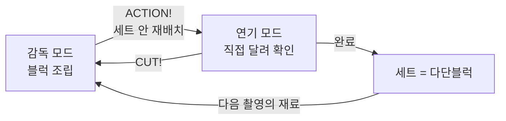
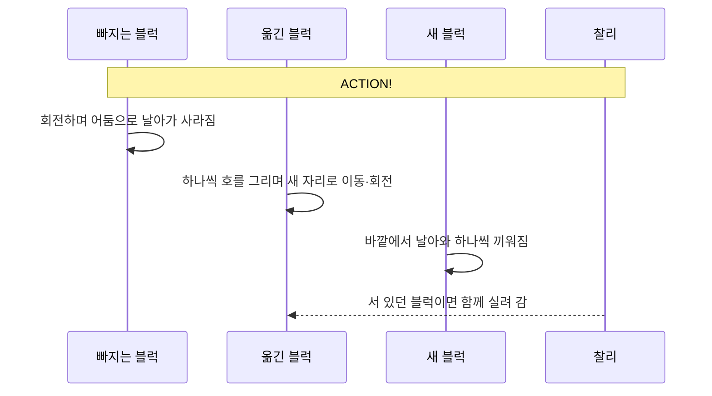
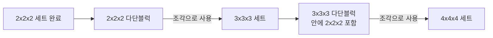

# Director's Cut — 핵심 메커니즘

> 이 게임을 이 게임답게 만드는 규칙만 모은 문서.
> 전체 흐름, 홈, UI, 연출 세부는 [전체 기획서](기획서_전체.md)를 참고한다.

---

## 한 줄 요약

**빈 정육면체 세트를 블럭으로 조립해 길을 만들고(감독), 그 길을 직접 달려 확인하며(배우), 완성한 세트는 다음 세트의 블럭이 된다.**

핵심 메커니즘은 여섯 가지다.

1. [블럭 조립](#1-블럭-조립)
2. [회전하면 안의 맵도 회전한다](#2-회전하면-안의-맵도-회전한다)
3. [벽이 아니라 발판이 길을 만든다](#3-벽이-아니라-발판이-길을-만든다)
4. [감독 ↔ 연기 순환과 세트 안 재배치](#4-감독--연기-순환과-세트-안-재배치)
5. [어둠과 재촬영](#5-어둠과-재촬영)
6. [다단블럭: 내가 만든 세트가 다음 재료가 된다](#6-다단블럭-내가-만든-세트가-다음-재료가-된다)

---

## 1. 블럭 조립

### 규칙
- 세트는 정육면체 그리드다 (2x2x2 → 3x3x3 → 4x4x4).
- 그리드의 한 칸 = **블럭** 하나. 블럭은 독립된 컨셉을 가진 작은 맵이다.
- 플레이어가 받는 재료는 **단블럭**: 블럭 4개 이하가 붙은 조각.
- **시작 지점**(아래층)과 **도착 지점**(위층) 칸은 고정이고, 나머지 칸을 모두 채워야 한다.
- 조각은 빈 칸에만 놓을 수 있고, 세트 밖으로 삐져나오거나 다른 조각과 겹칠 수 없다.

### 플레이어의 선택
| 선택 | 의미 |
|---|---|
| 어떤 조각을 | 조각마다 블럭 컨셉(=그 안의 지형)이 다르다 |
| 어디에 | 위치에 따라 이웃 블럭과의 연결이 바뀐다 |
| 어느 방향으로 | 회전하면 안의 맵도 함께 돈다 (2장) |

### 설계 의도
- 조각 모양이 제약이 된다. 여러 칸짜리 조각은 원하는 곳 옆의 필요 없는 칸까지 차지한다.
- "길을 만드는 퍼즐"과 "빈칸 없이 채우는 퍼즐"이 동시에 걸린다. 길은 다 만들었는데 남은 조각이 길을 막는 상황이 핵심 긴장이다.

---

## 2. 회전하면 안의 맵도 회전한다

### 규칙
- 조각은 24방향(정육면체의 모든 방향)으로 회전할 수 있다.
- 조각을 돌리면 그 조각에 속한 블럭들의 **내부 맵도 똑같이 회전**한다.
- 중력은 항상 세트의 아래 방향이다. 블럭이 돌아가도 중력은 돌지 않는다.

### 결과
| 넣은 방향 | 그 블럭 안에서 일어나는 일 |
|---|---|
| 바로 세움 | 설계된 대로의 지형 |
| 옆으로 눕힘 | 바닥이 벽이 되고, 계단·발판이 벽에 붙은 모양이 된다 |
| 뒤집음 | 바닥이 천장이 된다. 위층에 있으면 아래층의 지붕이자 위층의 바닥이 된다 |

### 설계 의도
- 같은 조각도 방향에 따라 전혀 다른 지형이 된다. 조각 수가 적어도 경우의 수가 크다.
- 모양을 맞추려고 돌리면 지형이 망가지고, 지형을 지키려고 세우면 모양이 안 맞는다. **모양과 지형 사이의 줄다리기**가 조립 퍼즐의 깊이다.
- 감독 모드에서는 블럭의 바닥 방향만 표시해서, 돌렸을 때 어떻게 될지 짐작은 할 수 있게 한다.

---

## 3. 벽이 아니라 발판이 길을 만든다

### 외면 / 내면
- 블럭의 각 면은 세트 안 위치에 따라 정해진다.
  - **외면**: 세트 바깥 테두리를 향하는 면 → 벽
  - **내면**: 세트 안쪽을 향하는 면 → **벽 없음**
- 그래서 세트 안쪽은 칸 구분 없이 하나로 트인 공간이다. 블럭은 바닥 가장자리의 색 띠로만 구분된다.

### 블럭 사이 이동
벽이 없으니 "지나갈 수 있느냐"가 아니라 **"발판이 이어지느냐"**가 문제다.

| 방향 | 이어지는 조건 |
|---|---|
| 옆 블럭 | 맞닿은 쪽 바닥/발판이 이어져 있으면 걸어서 건넌다 |
| 위 블럭 | 아래 블럭의 오르막이 끝나는 자리 바로 위에, 위 블럭 바닥의 **구멍**이 있어야 올라간다 |
| 아래 블럭 | 바닥 구멍으로 떨어져 내려간다 |

- 블럭마다 바닥에서 천장 높이까지 오를 수 있는 **오르막**이 하나씩 있다. 오르막 꼭대기는 위 블럭 바닥에 한 번 점프로 올라설 수 있는 높이다.
- 위층으로 가는 길은 **아래 블럭의 오르막 끝**과 **위 블럭의 바닥 구멍**이 맞아야 열린다. 회전(2장)은 둘 다 바꾼다.

### 숨기는 정보
- 감독 모드에서는 발판 배치와 연결 여부를 **보여 주지 않는다.**
- 연결은 직접 들어가서 확인한다. 이 시행착오가 연기 모드의 의미다.

---

## 4. 감독 ↔ 연기 순환과 세트 안 재배치

### 두 모드
| | 감독 모드 | 연기 모드 |
|---|---|---|
| 하는 일 | 블럭 배치·회수·회전 | 세트 안을 직접 달림 |
| 시점 | 세트를 내려다보는 조립 화면 | 3인칭 |
| 찰리 | 세트 밖 감독 의자에 앉아 있고, 세트 안에는 대역이 서 있다 | 직접 조작 |
| 진입 | 연기 중 언제든 (CUT!) | 편집을 마치면 (ACTION!) |

### 언제든 편집, 서 있는 블럭도 편집
- 연기 도중 언제든 감독 모드로 들어갈 수 있다.
- **지금 서 있는 블럭**도 옮기고, 돌리고, 뺄 수 있다.

### 세트 안 재배치
편집 결과는 감독 모드 화면에서 끝나지 않는다. 연기 모드로 돌아오면 **세트 안에서, 찰리 주변에서** 바뀐 내용이 실제로 일어난다.

| 규칙 | 내용 |
|---|---|
| 바뀐 것만 | 바뀐 블럭만 움직인다. 바뀐 게 없으면 바로 돌아온다 |
| 순서 | 빠지기 → 옮기기(하나씩) → 끼우기(하나씩) |
| 길이 | 최대 2초. 많이 바꾸면 전체 속도를 올린다 |
| 건너뛰기 | 키 하나로 즉시 끝낼 수 있다 |
| 찰리 탑승 | 서 있던 블럭이 옮겨지면 찰리도 그 블럭 안의 같은 자리에 실려 함께 이동·회전한다 |
| 찰리 낙하 | 서 있던 블럭을 뺐으면 찰리도 그 블럭과 함께 어둠으로 날아간다 → 재촬영(5장) |

### 설계 의도
- 재배치는 장식이 아니라 **내가 무엇을 바꿨는지 보여 주는 정보**다.
- 내가 서 있는 세계가 내 손으로 재조립되는 장면(인셉션 같은 느낌)이 이 게임의 대표 장면이다.
- 모드 전환은 자주 일어나므로 빠르게 유지한다. 긴 연출(크레인)은 촬영마다 처음 한 번만이다.

---

## 5. 어둠과 재촬영

### 어둠
- 아직 채우지 않은 칸은 **아무것도 없는 공간(어둠)**이다. 그 너머 블럭 내부가 그대로 보인다.
- 어둠에 들어가면 **재촬영**(사망)이다.
- 톱니·멜빵·도착 지점은 어둠 너머로도 항상 보여서, 어디로 길을 내야 할지 구상할 수 있다.

### 복귀 규칙
| 상황 | 복귀 위치 |
|---|---|
| 어둠에 들어감 | 떨어지기 직전에 밟고 있던 발판 |
| 그 발판의 블럭이 편집으로 옮겨졌음 | 옮겨진 블럭 안의 같은 발판 |
| 그 발판의 블럭이 편집으로 빠졌음 | 시작 지점 |

- 복귀 지점은 세계 좌표가 아니라 **"어느 블럭의 어느 자리"**로 기억한다. 그래서 편집으로 블럭이 움직여도 정확히 따라간다.
- 페널티는 가볍다. 빨리 돌아와서 다시 시험하게 하는 것이 목적이다.

---

## 6. 다단블럭: 내가 만든 세트가 다음 재료가 된다

### 규칙
- 촬영을 완료하면 그 세트 전체가 **다단블럭** 하나로 저장된다.
- 다단블럭에는 내가 조립한 배치와 각 블럭의 회전이 그대로 들어 있다.
- 다음, 더 큰 세트에서 다단블럭을 하나의 조각처럼 넣을 수 있다. 24방향 회전도 되고, 돌리면 안의 세트 전체가 돈다.

### 껍데기와 잠긴 패널
- 다단블럭은 원래 세트였으므로 바깥 껍데기가 있다.
- 새 세트에 넣었을 때 껍데기 면이

| 향하는 곳 | 결과 |
|---|---|
| 새 세트의 테두리 | 세트 외벽과 합쳐져 그냥 벽 |
| 새 세트의 안쪽 | **나사 4개로 잠긴 패널** |

- 잠긴 패널은 단단한 면이라 **발판이나 벽으로 쓸 수 있다.**
- 세트 안의 **멜빵**을 얻으면 스패너가 생기고, 패널 꼭짓점의 나사 4개를 모두 풀면 그 면이 열려 다단블럭 안으로 들어갈 수 있다.
- 멜빵은 그 촬영 안에서만 유효하다.

### 다단블럭을 쓰는 이유
| 경우 | 설명 |
|---|---|
| 필수 | 조각이 모자라서 다단블럭 없이는 세트를 다 채울 수 없다 |
| 선택 | 다단블럭 안의 구조가 이번 경로에 유리하면 쓴다. 대신 다른 조각이 남는다 |
| 닫거나 열거나 | 닫힌 채 큰 지형(발판·벽)으로 쓰거나, 열어서 안의 경로를 쓴다 |

### 설계 의도
- **과거의 내 감독판이 현재 퍼즐의 재료가 된다.** Director's Cut 주제와 가장 직접적으로 연결되는 장치다.
- 내가 대충 만든 세트는 다음 촬영에서 쓰기 불편하고, 잘 만든 세트는 다음 촬영의 지름길이 된다. 조립 하나하나가 이후 플레이에 남는다.

---

## 부록: 퍼즐이 항상 풀리도록

- 촬영마다 **정답 배치를 먼저 만들고**, 그 정답을 이루는 조각들을 무작위로 돌려서 준다.
- 정답 배치에서 시작 지점 → 도착 지점까지 실제로 갈 수 있는지를 단순화한 모델(바닥 구멍과 오르막 끝 위치)로 검사하고, 안 되면 다시 만든다.
- 톱니와 멜빵은 정답 배치에서 도달할 수 있는 자리에만 놓는다.
- 그래서 모든 촬영에는 적어도 하나의 정답이 있고, 플레이어는 정답과 다른 자기만의 배치를 찾아도 된다.
